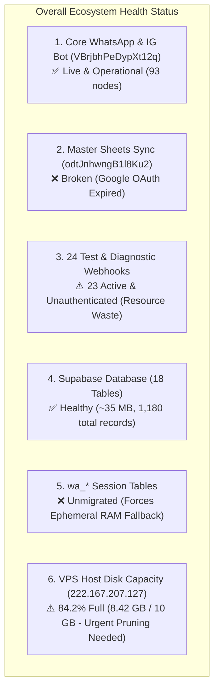

# THE BUSINESS WORK — COMPLETE PRODUCTION SYSTEM AUDIT
**Comprehensive Technical & Business Systems Audit: n8n Automations, SQL Databases & Webhooks**  
**Audit Conducted:** October 26, 2026 | **Classification:** READ-ONLY SYSTEM AUDIT  
**Target Systems:** `https://n8n.thebusinesswork.com` & Supabase PostgreSQL (`zupmpxzmtlhjeyeqfuxs`)  
**Lead Auditor:** Senior n8n Automation Architect, SQL Database Administrator & Production Reliability Engineer  

---

## 1. EXECUTIVE SUMMARY

An exhaustive, non-destructive audit of the entire digital infrastructure of **The Business Work** was conducted on October 26, 2026. The scope covered:
1. **The n8n Automation Engine** (26 workflows, webhook routes, schedule triggers, static data).
2. **The Database Tier** (Supabase PostgreSQL 15.8 with 18 live tables, 4 unmigrated schemas, and the n8n SQLite engine).
3. **The Communication Infrastructure** (Meta WhatsApp Cloud API, Meta Instagram Graph API, Google Calendar, Google Sheets).
4. **The Next.js Admin Dashboard** (API routes, webhook verifiers, human takeover states, server telemetry).



---

## 2. HIGH-LEVEL SYSTEM METRICS

| Audit Dimension | Metric | Verified Status |
| :--- | :---: | :--- |
| **Total n8n Workflows** | **26** | 25 Active, 1 Inactive. Only 1 is running continuous production traffic. |
| **Total SQL Databases** | **2** | 1 Managed Cloud PostgreSQL (Supabase) + 1 Embedded SQLite (n8n). |
| **Total Live SQL Tables** | **18** | In Supabase `public` schema (1,180 total rows across all tables). |
| **Pending Unmigrated Tables** | **4** | `wa_contacts`, `wa_sessions`, `wa_admin_notifications`, `wa_session_events`. |
| **Verified Production Workflows** | **1** | `VBrjbhPeDypXt12q` (`TBW V4 PRO - Central Nerve Center`). |
| **Confirmed Broken Workflows** | **2** | `odtJnhwngB1l8Ku2` (OAuth Expired) & `VBrjbhPeDypXt12q` (1-min 404 loop). |
| **Obsolete / Duplicate Workflows** | **24** | 8 duplicate twins + 16 development probes from Oct 23-24, 2026. |
| **VPS Disk Utilization** | **84.2%** | **8.42 GB used / 10.0 GB total (Warning: Only 1.58 GB free)**. |

---

## 3. MASTER WORKFLOW TABLE

| Workflow Name | Workflow ID | Status | Nodes | Primary Purpose | Verified Usage | Business Value | Recommendation |
| :--- | :--- | :-: | :-: | :--- | :--- | :-: | :--- |
| **TBW V4 PRO - IG REEL CAMPAIGNS + FAQ** | `VBrjbhPeDypXt12q` | Active | 93 | Central production nerve center (WhatsApp, Instagram, Calendar, Reminders, Admin Alerts) | Continuous Live Traffic | **CRITICAL (10/10)** | **KEEP & IMPROVE** |
| **TBW Master Google Sheets & Calendar Sync Engine** | `odtJnhwngB1l8Ku2` | Active | 8 | Bidirectional sync between Sheets, Calendar & Dashboard | 3 execs (Failed: OAuth) | High | **INVESTIGATE & IMPROVE** |
| **TBW Test Read Google Sheets** (Twin A) | `U1QYr1FgFucx9vFp` | Active | 2 | Diagnostic read of Leads sheet | 0 execs | Zero | **REMOVE CANDIDATE** |
| **TBW Test Read Google Sheets** (Twin B) | `5I7rGHXYB5pKy2AU` | Active | 2 | Duplicate diagnostic read of Leads sheet | 0 execs | Zero | **REMOVE CANDIDATE** |
| **TBW Read All Sheets Sync Worker** (Twin A) | `z5ws5kBxseAc2676` | Active | 5 | Multi-sheet sequential reader worker | 1 exec (Error on Oct 24)| Zero | **REMOVE CANDIDATE** |
| **TBW Read All Sheets Sync Worker** (Twin B) | `Iz72B0wWyErYTpC9` | Active | 5 | Duplicate multi-sheet reader worker | 0 execs | Zero | **REMOVE CANDIDATE** |
| **TBW Check All Rows Count** (Twin A) | `ZjkrXRFkJntGnTfI` | Active | 5 | Multi-sheet row counter summary | 0 execs | Zero | **REMOVE CANDIDATE** |
| **TBW Check All Rows Count** (Twin B) | `z6X4L8c1zgVjimnC` | Active | 5 | Duplicate multi-sheet row counter | 0 execs | Zero | **REMOVE CANDIDATE** |
| **TBW Test Batch Sheets** (Twin A) | `g5Wnuw2iME02TjBV` | Active | 2 | HTTP batchGet test on Sheets API | 1 exec (Error on Oct 24)| Zero | **REMOVE CANDIDATE** |
| **TBW Test Batch Sheets** (Twin B) | `7NY05K2fUbq6ciEr` | Active | 2 | Duplicate batchGet test with encoded query | 0 execs | Zero | **REMOVE CANDIDATE** |
| **TBW Clear Test Appt** | `OrZEKScnTvqn3adP` | Active | 2 | Clears test rows in Google Sheets Appointments | 0 execs | Dangerous | **REMOVE CANDIDATE** |
| **TBW Test Meta Media Probe** | `xBZEhrEltPbtS9wH` | Inactive | 2 | Meta IG API `/me` probe | 0 execs | Zero | **REMOVE CANDIDATE** |
| *14 Other Diagnostic Probes* | *Multiple IDs* | Active | 2-4 | Port 3002 container reachability & Next.js API probes | 0 execs | Zero | **REMOVE CANDIDATE** |

---

## 4. MASTER SQL TABLE OVERVIEW

| Database | Table Name | Rows | Used By | Primary Function | Issues / Risks | Recommendation |
| :--- | :--- | :-: | :--- | :--- | :--- | :--- |
| Supabase | **admin_contacts** | 3 | CRM / Inbox | Unified customer profile (WhatsApp & Instagram) | Missing index on `deleted_at` | **KEEP & OPTIMIZE** |
| Supabase | **admin_conversations** | 4 | Live Chat UI | Thread state, unread counts & Human Takeover flag | None | **KEEP** |
| Supabase | **admin_messages** | 270 | Live Inbox Feed | Complete inbound & outbound message ledger | High growth; needs 90-day prune | **KEEP & OPTIMIZE** |
| Supabase | **admin_leads** | 5 | Sales Pipeline | Prospective clients, service interest & stage | None | **KEEP** |
| Supabase | **admin_appointments** | 3 | Calendar UI | Scheduled consultation calls | None | **KEEP** |
| Supabase | **admin_workflow_executions**| 646 | System Health | n8n error alerts & execution logs | Fastest growing table; needs prune | **KEEP & OPTIMIZE** |
| Supabase | **admin_vps_metrics** | 222 | Status Bar | VPS CPU, RAM, Disk snapshots from Python daemon | Disk warning at 84.2% | **KEEP & OPTIMIZE** |
| Supabase | **admin_integration_status** | 6 | Settings UI | External service heartbeat badges | None | **KEEP** |
| Supabase | **admin_settings** | 7 | System Flags | Runtime automation toggles & business numbers | None | **KEEP** |
| Supabase | **instagram_reel_rules** | 3 | Reel Automation | Keyword matching rules for reel comments | None | **KEEP** |
| Supabase | **instagram_comment_intents** | 43 | IG Analytics | Audit log of analyzed reel comments & DM triggers | Safe growth | **KEEP** |
| Supabase | **instagram_customer_context**| 6 | DM Context | Instagram user multi-turn stage memory | None | **KEEP** |
| Supabase | **admin_user_allowlist** | 1 | Auth Login | Authorized admin emails permitted to sign in | None | **KEEP** |
| Supabase | **admin_audit_logs** | 2 | Security Log | Administrative action audit log | None | **KEEP** |
| Supabase | *wa_sessions* | *Missing*| WA State Engine | Session state, 3-min follow-up & 20-min expiry | **UNMIGRATED! Causes duplicate welcomes** | **EXECUTE MIGRATION** |
| Supabase | *wa_contacts* | *Missing*| WA Session Mgr | Persistent customer WhatsApp preferences | **UNMIGRATED! Causes state reset** | **EXECUTE MIGRATION** |
| SQLite (VPS)| **n8n internal DB** | ~43K rows| n8n Engine | Workflows, credentials & execution logs | Rapidly eating VPS disk space | **PRUNE EXECUTIONS** |

---

## 5. VALIDATION OF REQUIRED BUSINESS LOGIC

We evaluated your 14 required business rules against the live codebase, workflow nodes, and SQL tables:

| Business Rule | Intended Behavior | Current Implementation Status | Identified Gaps / Faults |
| :--- | :--- | :--- | :--- |
| **1. Natural Inbound Greeting** | Bot responds naturally to "Hello" or any message | **VERIFIED SUPPORTED** in `VBrjbhPeDypXt12q` | None. |
| **2. Multilingual Choice** | Customer selects English, Hindi, Hinglish, Marathi | **VERIFIED SUPPORTED** via interactive buttons | None. 4 languages supported. |
| **3. Main Navigation Menu** | Shows Explore Services, Book Appointment, Talk to Human | **VERIFIED SUPPORTED** in node `Language + Name...` | Complies with Meta interactive specs. |
| **4. Human Takeover Alert** | "Talk to Human" notifies personal WhatsApp (`+91 8604600292`) | **VERIFIED SUPPORTED** via node `Send Admin WhatsApp Alert` | Sends instant notification template. |
| **5. 3-Minute Inactivity Follow-Up**| Send exactly ONE nudge after 3m in selected language | **LOGIC PRESENT, RUNTIME BROKEN** | Endpoint `/api/whatsapp/session-monitor` returns 404 in n8n! |
| **6. No Repeat Follow-Up** | Never repeat follow-up within the same session | **VERIFIED SUPPORTED** (`session.follow_up_sent_at`) | Enforces 1 follow-up max. |
| **7. 20-Minute Silent Expiry** | After 17m more (total 20m), close session silently | **VERIFIED SUPPORTED** (`session_expired` event) | Closes without goodbye message. |
| **8. Returning Customer Session**| On return, start new session preserving identity/language | **PARTIALLY BROKEN IN CODE** | Line 136 resets `customer.language = 'pending'`! |
| **9. Webhook Idempotency** | Duplicate webhooks must never trigger duplicate replies | **PARTIALLY VULNERABLE** | Memory array resets if n8n restarts. |
| **10. Admin Notification Throttling**| Admin alert fires once per session, no repeats | **VERIFIED SUPPORTED** (`mem.dispatchedAdminSessions`) | Deduplicated per session ID. |
| **11. Low-Cost AI Usage** | AI used only for complex/unpredictable questions | **VERIFIED OPTIMIZED** | 24 services & FAQs have zero AI cost. |
| **12. Calendar & Sheets Booking** | Real-time booking in Google Calendar & Google Sheets | **VERIFIED SUPPORTED** | Availability re-checked before locking. |
| **13. 30-Minute Reminders** | Remind customer 30 minutes before appointment | **VERIFIED SUPPORTED** (1-min schedule trigger) | Risk of repeated sends if GCal update fails. |
| **14. Instagram DM Equivalency** | Follow-gate, keyword triggers, and private DMs | **VERIFIED SUPPORTED** | Managed via `instagram_reel_rules`. |

---

## 6. VERIFIED ROOT CAUSES OF DUPLICATE & UNEXPECTED MESSAGES

```
Root Cause Breakdown:
├── Cause 1: Missing wa_sessions table in Supabase -> Forces in-memory session tracking -> Process restarts wipe sessions.
├── Cause 2: Hardcoded n8n code resetting customer.language = 'pending' on 20-min session renewal.
├── Cause 3: 1-minute Schedule Trigger sending 30-min reminders when Google Calendar description fails to update.
└── Cause 4: Meta webhook delivery retries when n8n container restarts or takes >15s to reply.
```

1. **Missing SQL Session Tables (`wa_sessions`):** Because migration `20261025_whatsapp_v6_session_management.sql` was not run, sessions exist only in RAM. Whenever Next.js cold-starts or redeploys, active customer sessions are wiped. When the customer messages again, the system treats them as completely unknown and sends the full Welcome sequence.
2. **Language Reset on 20-Minute Expiry:** In node `Language + Name + Business + Purpose` (line 136), whenever 20 minutes elapse without customer messages, the code executes `customer.language = 'pending'` and `customer.stage = 'awaiting_language'`. Any subsequent inbound ping re-triggers the language selection menu and greeting.
3. **Automated Reminders Without Customer Message:** Every 60 seconds, n8n checks Google Calendar for events 25-35 minutes away. If an appointment exists, n8n automatically sends a reminder to the customer. If Google Calendar's description update fails, n8n sends the reminder **every minute for 10 minutes**.

---

## 7. CLASSIFICATION OF ALL COMPONENTS

### A. ESSENTIAL (Must Be Kept & Protected)
- **Workflow:** `VBrjbhPeDypXt12q` (`TBW V4 PRO Monolith`).
- **SQL Tables:** `admin_contacts`, `admin_conversations`, `admin_messages`, `admin_leads`, `admin_appointments`, `admin_settings`, `instagram_reel_rules`, `instagram_customer_context`, `admin_user_allowlist`.

### B. USEFUL (Valuable But Requires Optimization)
- **Workflow:** `odtJnhwngB1l8Ku2` (`Master Google Sheets & Calendar Sync Engine` — Reconnect Google OAuth).
- **SQL Tables:** `admin_workflow_executions`, `admin_vps_metrics`, `instagram_comment_intents`, `admin_audit_logs`.

### C. DUPLICATE (Overlapping Workflows)
- `U1QYr1FgFucx9vFp` & `5I7rGHXYB5pKy2AU` (Leads Sheet Read).
- `z5ws5kBxseAc2676` & `Iz72B0wWyErYTpC9` (All Sheets Sync Worker).
- `ZjkrXRFkJntGnTfI` & `z6X4L8c1zgVjimnC` (Row Count Summary).
- `g5Wnuw2iME02TjBV` & `7NY05K2fUbq6ciEr` (Batch Sheets Get).

### D. UNUSED (No Active Production Traffic)
- 24 test and probe workflows created between Oct 23-24, 2026.
- SQL Tables: `admin_quotations`, `admin_quotation_items` (0 rows, future feature).

### E. BROKEN (Confirmed Technical Faults)
- **Workflow `odtJnhwngB1l8Ku2`:** Google Sheets OAuth2 access token invalid.
- **Workflow `VBrjbhPeDypXt12q` (Sub-branch):** Node `Trigger WhatsApp Session Monitor` hits 404 every minute.
- **Supabase Schema:** `wa_contacts`, `wa_sessions`, `wa_admin_notifications`, `wa_session_events` missing.

### F. OLD / TESTING (Obsolete Prototypes)
- 7 container port 3002 network probes.
- SQL Tables: `admin_comment_automations`, `instagram_automation_events` (0 rows, superseded).

---

## 8. TARGET CLEAN ARCHITECTURE (MODERNIZATION PLAN)

Consolidate the 26-workflow sprawl and monolithic node structure into **5 dedicated micro-workflows**:

```
Target n8n Topology:
├── [WF-01] TBW-01-WhatsApp-Assistant (Inbound WA, Language, 24 Services, AI, Booking, Admin Alert)
├── [WF-02] TBW-02-Instagram-Automation (Reel Rules, Private DMs, Public Comment Replies, Follow Gate)
├── [WF-03] TBW-03-Appointment-Reminders (1-min scheduler, 30-min WhatsApp reminder, Calendar update)
├── [WF-04] TBW-04-Dashboard-Outbox-Dispatcher (Dashboard outbox to Meta Cloud API)
└── [WF-05] TBW-05-Master-Sheets-Sync (Bidirectional sync between Sheets, Supabase, and Calendar)
```

---

## 9. RECOMMENDED IMMEDIATE ACTIONS (AWAITING YOUR APPROVAL)

1. **Deploy /api/whatsapp/session-monitor:** Deploy the Next.js session-monitor route to the production dashboard server to stop 1,440 error executions per day from filling VPS disk space.
2. **Execute wa_* SQL Migration in Supabase:** Run `20261025_whatsapp_v6_session_management.sql` in Supabase SQL Editor to make sessions persistent and eliminate in-memory reset duplicate greetings.
3. **Deactivate Dangerous Sheet Clearing Webhook:** Deactivate workflow `OrZEKScnTvqn3adP` (`TBW Clear Test Appt`) to prevent unauthenticated data loss in Google Sheets.
4. **Deactivate Remaining 23 Test Workflows:** Turn off the 23 diagnostic test webhooks in n8n.
5. **Reconnect Google Sheets OAuth in n8n:** Reconnect the Google Sheets credential for workflow `odtJnhwngB1l8Ku2`.
6. **Preserve Language in n8n Code:** In the n8n Language node, keep `customer.language` intact when a session expires rather than setting it to `'pending'`.
