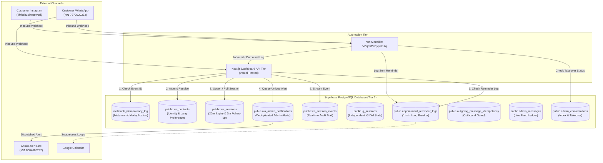

# THE BUSINESS WORK — SQL DEPENDENCY & INTEGRATION REPORT
**Technical Architecture Specification & Data Flow Dependency Map**  
**Audit Scope:** Supabase PostgreSQL Tables, Foreign Keys, Stored Functions, Next.js Routes, n8n Nodes  
**Date:** October 26, 2026 | **Author:** Senior PostgreSQL DBA & Automation Architect  

---

## 1. END-TO-END SYSTEM INTEGRATION ARCHITECTURE

The diagram below maps every database entity to its reading and writing applications:

---

## 2. TABLE-BY-TABLE DEPENDENCY MAPPING

### 1. `public.wa_contacts`
- **Primary Key:** `id` (UUID)
- **Unique Constraints:** `normalized_phone` (Digits only, E.164 without plus)
- **Columns Added in 20261026:** `preferred_language`, `preferences`, `is_blocked`, `total_sessions_count`
- **Application Reads:**
  - `src/lib/whatsapp/session-manager.ts` (`resolveSessionForInbound`, `isContactDeleted`)
  - `src/app/api/whatsapp/contacts/route.ts` (Admin Contacts view)
  - Stored function: `public.register_inbound_customer_message`
- **Application Writes:**
  - `src/lib/whatsapp/session-manager.ts` (Upserts new phone profile, updates `last_seen_at`)
  - `src/app/api/whatsapp/contacts/[id]/delete/route.ts` (Soft delete `deleted_at = now()`)
- **Foreign Key Inbound:** Referenced by `public.wa_sessions(contact_id)` ON DELETE SET NULL.
- **Business Rule Satisfied:** Rule 11 — Preserves customer identity and language preference across sessions.

---

### 2. `public.wa_sessions`
- **Primary Key:** `id` (UUID)
- **Unique Constraints:** `session_id` (Text)
- **Columns Added in 20261026:** `customer_phone`, `follow_up_status`, `last_customer_activity_at`
- **Foreign Keys:** `contact_id` REFERENCES `public.wa_contacts(id)` ON DELETE SET NULL
- **Application Reads:**
  - `src/app/api/whatsapp/session-monitor/route.ts` (Cron polling for 3m follow-up and 20m expiry)
  - `src/lib/whatsapp/session-manager.ts` (`getAllSessions`)
  - Stored function: `public.claim_wa_follow_up_atomic` (Uses `FOR UPDATE SKIP LOCKED`)
- **Application Writes:**
  - Stored function `public.register_inbound_customer_message` (Creates new or updates active)
  - Stored function `public.record_bot_outgoing_dispatch` (Sets `awaiting_customer = true`, does NOT reset customer timer)
  - Stored function `public.expire_wa_sessions_atomic` (Transitions status to `EXPIRED`)
- **Business Rules Satisfied:**
  - Rule 6 & 7: 3-minute single follow-up guarantee.
  - Rule 8 & 9: 20-minute automatic inactivity session closure without outbound messages.
  - Rule 14 & 15: AI messages strictly forbidden from altering customer inactivity timer.

---

### 3. `public.wa_admin_notifications`
- **Primary Key:** `id` (UUID)
- **Unique Constraints:** `uq_wa_admin_notifications_session_type (session_id, notification_type)`
- **Foreign Keys:** None (Loose coupling by `session_id` to allow archival)
- **Application Reads:**
  - `src/app/api/whatsapp/admin-alert/route.ts` (Admin alerts feed)
  - `src/lib/whatsapp/admin-alert.ts` (`getAllAdminNotifications`)
- **Application Writes:**
  - `src/lib/whatsapp/admin-alert.ts` (`sendAdminWhatsAppNotification` inserts record)
  - Stored function `public.trigger_human_takeover_atomic` (Inserts `HUMAN_TAKEOVER_REQUEST`)
- **Business Rule Satisfied:** Rule 5 — Exactly ONE human takeover alert dispatched per request.

---

### 4. `public.webhook_idempotency_log`
- **Primary Key:** `event_id` (Text, Meta `wamid` or IG `mid`)
- **Application Reads & Writes:**
  - `src/app/api/whatsapp/webhook/route.ts` (First line of defense against Meta retry storms)
  - `src/app/api/n8n/webhook/route.ts` (Webhook deduplication gate)
  - Stored function `public.register_inbound_customer_message`
- **Retention Policy:** Records older than 14 days can be pruned safely.
- **Business Rule Satisfied:** Rule 12 — Webhook deduplication.

---

### 5. `public.appointment_reminder_logs`
- **Primary Key:** `id` (UUID)
- **Unique Constraints:** `uq_appointment_reminder (calendar_event_id, reminder_type)`
- **Foreign Keys:** `appointment_id` REFERENCES `public.admin_appointments(id)` ON DELETE SET NULL
- **Application Reads & Writes:**
  - n8n workflow `VBrjbhPeDypXt12q` node `Every Minute - Appointment Reminders`
  - Stored function `public.can_send_appointment_reminder`
  - Stored function `public.record_appointment_reminder_atomic`
- **Business Problem Solved:** Eliminates infinite WhatsApp reminder spam when Google Calendar updates fail.

---

### 6. `public.ig_sessions` & `public.ig_session_events`
- **Primary Key:** `id` (UUID)
- **Unique Constraints:** `session_id` (Text)
- **Foreign Keys:** None (Direct IGSID lookup via `ig_user_id`)
- **Application Reads & Writes:**
  - `src/lib/instagram/reel-automation.ts` (`evaluateDmContext`, `evaluateCommentCheck`)
  - n8n Instagram comment-to-DM flows
- **Business Rule Satisfied:** Rule 13 — Complete architectural isolation between WhatsApp and Instagram sessions.

---

## 3. STORED FUNCTIONS & CONCURRENCY PROTOCOLS

| Function Name | Return Type | Concurrency Mechanism | Intended Caller |
| :--- | :--- | :--- | :--- |
| `claim_wa_follow_up_atomic` | `TABLE (...)` | `SELECT ... FOR UPDATE SKIP LOCKED` | Session monitor cron worker |
| `expire_wa_sessions_atomic` | `INT` (Count) | `SELECT ... FOR UPDATE SKIP LOCKED` | Session monitor cron worker |
| `register_inbound_customer_message`| `TABLE (...)` | Row-level locks on `wa_contacts` & `wa_sessions` | Webhook ingestion endpoint |
| `record_bot_outgoing_dispatch` | `VOID` | Atomic single-row update | Outbound message dispatcher |
| `trigger_human_takeover_atomic` | `TABLE (...)` | Atomic multi-table transaction + ON CONFLICT DO NOTHING | "Talk to Human" button handler |
| `can_send_appointment_reminder` | `BOOLEAN` | Read-only index scan | n8n reminder schedule node |
| `record_appointment_reminder_atomic`| `BOOLEAN` | `ON CONFLICT DO NOTHING` | n8n reminder sender node |
