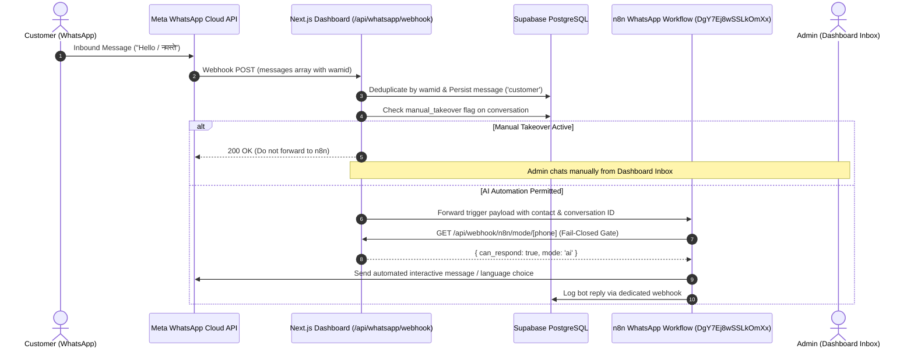
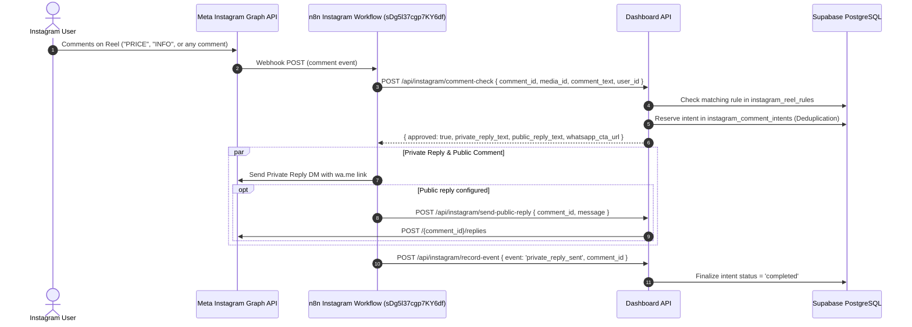

# THE BUSINESS WORK — CLEAN TWO-DOMAIN INTEGRATION ARCHITECTURE (PHASE 6)
**Document:** Modular Architecture Plan & Event Contracts for Two Replacement n8n Workflows  
**Workflows in Scope:**  
- **WhatsApp Automation:** `https://n8n.thebusinesswork.com/workflow/DgY7Ej8wSSLkOmXx` (ID: `DgY7Ej8wSSLkOmXx`)  
- **Instagram Automation:** `https://n8n.thebusinesswork.com/workflow/sDg5l37cgp7KY6df` (ID: `sDg5l37cgp7KY6df`)  
**Auditor & Architect:** Principal Full-Stack Engineer, Next.js Architect & n8n Integration Specialist  
**Status:** ARCHITECTURAL SPECIFICATION (PENDING WORKFLOW JSON EXPORTS)  

---

## 1. ARCHITECTURAL PRINCIPLES & BOUNDARIES

To permanently solve previous duplicate replies, race conditions, and cross-channel pollution, the new architecture enforces seven fundamental rules:

1. **Strict Channel Isolation:**  
   WhatsApp and Instagram operate as completely independent domains. They share database models where appropriate (`admin_contacts`, `admin_conversations`, `admin_messages`), but have **zero shared workflow state** and **zero monolithic multi-channel router logic**.

2. **Single Responsibility per Action:**
   | Action | Responsible Owner | Execution Mechanism |
   | :--- | :--- | :--- |
   | **WhatsApp Automated Replies** | n8n Workflow `DgY7Ej8wSSLkOmXx` | Meta WhatsApp Cloud API via n8n |
   | **Instagram Public & Private Replies** | n8n Workflow `sDg5l37cgp7KY6df` | Meta Instagram Graph API via n8n |
   | **Human Takeover State & Locks** | Admin Dashboard / Supabase | `admin_conversations.manual_takeover` |
   | **Reel Campaign Rules & Matching** | Admin Dashboard / Supabase | `instagram_reel_rules` via `/api/instagram/comment-check` |
   | **Manual In-Dashboard Messages** | Admin Dashboard | Authenticated `/api/whatsapp/send` & `/api/instagram/send` |
   | **Lead Registration** | Admin Dashboard | Authenticated `/api/webhook/n8n/lead` |
   | **Appointment Booking** | Admin Dashboard | Authenticated `/api/webhook/n8n/appointment` |

3. **No In-Dashboard AI Model Invocation:**  
   The dashboard UI and Next.js backend do not invoke Gemini, OpenAI, or other LLMs directly. All conversation AI, language classification, and intent extraction are owned exclusively by n8n.

4. **Event Deduplication & Idempotency:**  
   Every incoming event must supply its canonical external identifier:
   - WhatsApp messages: `wamid`
   - Instagram DMs: `mid`
   - Instagram Comments: `comment_id`
   - Appointments: `calendar_event_id`
   - Leads: Normalized phone or IGSID

5. **Fail-Closed Takeover Protection:**  
   Before any automated message is dispatched by n8n, n8n queries `/api/webhook/n8n/mode/[phone]` or `/api/instagram/dm-context`. If the endpoint returns `can_respond: false` (or encounters a network error/timeout), n8n terminates execution immediately without sending a bot reply.

6. **Outbound Verification Before Delivery:**  
   If an admin took over the conversation while n8n was processing, the outgoing message logger will reject the bot message and log an audit event.

7. **Database as Single Source of Truth:**  
   All session timers, activity counters, and conversation histories reside in Supabase PostgreSQL, not in server memory or ephemeral container cache.

---

## 2. DOMAIN A: WHATSAPP INTEGRATION SPECIFICATION

### Target Workflow: `DgY7Ej8wSSLkOmXx`



### Supported Operations:
1. **Inbound Message Ingestion:** Receives official Meta webhooks, normalizes E.164 phone numbers, resolves `admin_contacts`, creates/updates `admin_conversations`, deduplicates by `wamid` in `admin_messages`.
2. **Takeover Gate:** Fast fail-closed query to `/api/webhook/n8n/mode/[phone]` returning `{ can_respond: boolean, mode: 'ai' | 'human' }`.
3. **Session Timing & Expiration:** Managed via database triggers and atomic RPCs (`claim_wa_follow_up_atomic`, `expire_wa_sessions_atomic`).
4. **Lead Capture Integration:** Transmits `{ name, phone, service, business, notes }` to `/api/webhook/n8n/lead`.
5. **Appointment Booking Integration:** Transmits `{ customer_name, phone, service, date, time }` to `/api/webhook/n8n/appointment`.
6. **Delivery & Read Receipts:** Meta webhook updates `admin_messages.status` (`sent` -> `delivered` -> `read`).

---

## 3. DOMAIN B: INSTAGRAM INTEGRATION SPECIFICATION

### Target Workflow: `sDg5l37cgp7KY6df`



### Supported Operations:
1. **Reel Comment Automation (Contract A):**
   - Ingests `comment_id`, `media_id`, `comment_text`, `user_id`, `username`.
   - Matches active campaign rule from `instagram_reel_rules` (Any Comment or Specific Keyword matching).
   - Enforces **One Private Reply per Comment** via atomic intent reservation.
   - Evaluates follow-gating if enabled.
   - Generates personalized WhatsApp CTA link (`https://wa.me/917972020292?text=...`).
2. **DM Context Resolution (Contract B):**
   - When a user enters the DM thread after clicking the private reply or sending a message, resolves their pending reel context via `/api/instagram/dm-context`.
   - Strict reel-to-reel isolation prevents campaigns from leaking across different reels.
3. **Public Comment Replies:**
   - Optional randomized public replies ("Sent you a DM! Check your requests 😊") via `/api/instagram/send-public-reply` with rate-limiting and recursion guards.
4. **Receipt Logging:**
   - Ingests delivery events via `/api/instagram/record-event`.

---

## 4. CONTRACT INTERFACES READY FOR CUTOVER

### Interface 1: Human Takeover Gate
- **Endpoint:** `GET /api/webhook/n8n/mode/[phone]`
- **Header:** `X-N8N-API-KEY: <N8N_WEBHOOK_SECRET>`
- **Response Format:**
  ```json
  {
    "success": true,
    "phone": "+918604600292",
    "conversation_id": "conv_uuid",
    "data": {
      "mode": "ai",
      "can_respond": true,
      "manual_takeover": false,
      "automation_paused": false
    }
  }
  ```

### Interface 2: Lead Ingestion
- **Endpoint:** `POST /api/webhook/n8n/lead`
- **Header:** `X-N8N-API-KEY: <N8N_WEBHOOK_SECRET>`
- **Request Format:**
  ```json
  {
    "name": "Customer Name",
    "phone": "+919876543210",
    "source": "whatsapp",
    "service": "AI Agents & Chatbots",
    "business": "Company Name",
    "notes": "Customer interested in multilingual WhatsApp bot"
  }
  ```

### Interface 3: Appointment Booking
- **Endpoint:** `POST /api/webhook/n8n/appointment`
- **Header:** `X-N8N-API-KEY: <N8N_WEBHOOK_SECRET>`
- **Request Format:**
  ```json
  {
    "customer_name": "Customer Name",
    "phone": "+919876543210",
    "service": "Consultation",
    "appointment_date": "2026-10-30",
    "appointment_time": "11:00 AM",
    "calendar_event_id": "google_event_id_or_n8n_id"
  }
  ```

### Interface 4: Reel Comment Check (Contract A)
- **Endpoint:** `POST /api/instagram/comment-check`
- **Header:** `X-N8N-API-KEY: <N8N_WEBHOOK_SECRET>`
- **Request Format:**
  ```json
  {
    "comment_id": "180123456789",
    "media_id": "179876543210",
    "comment_text": "PRICE",
    "user_id": "ig_user_scoped_id",
    "username": "client_username"
  }
  ```

### Interface 5: DM Context Resolution (Contract B)
- **Endpoint:** `POST /api/instagram/dm-context`
- **Header:** `X-N8N-API-KEY: <N8N_WEBHOOK_SECRET>`
- **Request Format:**
  ```json
  {
    "user_id": "ig_user_scoped_id",
    "username": "client_username",
    "message_text": "Hello"
  }
  ```

All interfaces are verified, authenticated, and prepared to connect cleanly with `DgY7Ej8wSSLkOmXx` and `sDg5l37cgp7KY6df` upon receipt of their JSON definitions.
