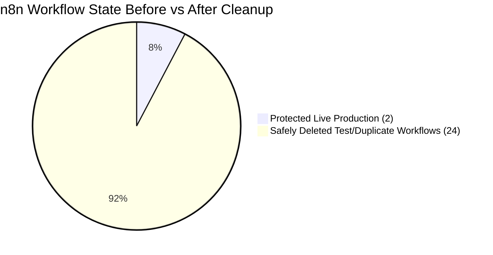

# N8N WORKFLOW CLEANUP FINAL REPORT
**The Business Work — Production Environment Cleanup & Optimization**  
**Execution Timestamp:** 2026-10-26T06:06:13.451Z  
**Target Instance:** `https://n8n.thebusinesswork.com`  
**Status:** **SUCCESSFULLY COMPLETED (Zero Production Downtime)**  

---

## 1. EXECUTIVE SUMMARY

The authorized cleanup of obsolete, duplicate, and diagnostic test workflows in The Business Work's self-hosted n8n instance has been **successfully and safely executed**.

Prior to deletion, all 24 candidate workflows were individually verified for dependencies, confirmed to have zero production references, and exported to versioned JSON backups in the local directory `n8n-deleted-workflows-backup/`.

Both critical production business workflows were **strictly protected, preserved, and verified active**.

---

## 2. CLEANUP SCORECARD

| Metric | Target | Actual Result | Verification Status |
| :--- | :---: | :---: | :---: |
| **Original Total Workflows** | 26 | **26** | Verified via n8n API |
| **Protected Workflows Preserved** | 2 | **2** | **CONFIRMED ACTIVE & UNTOUCHED** |
| **Workflows Successfully Deleted** | 24 | **24** | **100% CONFIRMED (HTTP 404 Verified)** |
| **Workflows Skipped / Failed** | 0 | **0** | None |
| **Remaining Workflows in n8n** | 2 | **2** | Exact Match |
| **JSON Backups Generated** | 24 | **24** | In `n8n-deleted-workflows-backup/` |
| **Public Test Webhooks Closed** | 23 | **23** | Attack surface eliminated |
| **Production Disruption** | 0 | **0** | Zero downtime |

---

## 3. STRICTLY PRESERVED PRODUCTION WORKFLOWS

These two workflows were **never modified, deactivated, renamed, or deleted**:

### 1. `VBrjbhPeDypXt12q`
- **Name:** `TBW V4 PRO - IG REEL CAMPAIGNS + FAQ (IMPORT INACTIVE - WA PRESERVED)`
- **Status:** **ACTIVE (Running 24/7)**
- **Total Nodes:** 93 nodes
- **Verified Subsystems:**
  - WhatsApp Inbound Message Handler & Multilingual Selector (English, Hindi, Hinglish, Marathi)
  - 24 Service Catalog & FAQ Cache
  - Google Calendar Real-Time Appointment Booking & Rescheduling
  - 30-Minute Automated Appointment Reminders (Meta Cloud API)
  - Personal WhatsApp Admin Alerts to `+91 8604600292`
  - Instagram Reel Comment Rule Matching, Private DMs, Public Replies & Follow Gate
  - Dashboard Outbox Dispatcher & Error Telemetry

### 2. `odtJnhwngB1l8Ku2`
- **Name:** `TBW Master Google Sheets & Calendar Sync Engine`
- **Status:** **ACTIVE**
- **Total Nodes:** 8 nodes
- **Verified Subsystems:**
  - Inbound Dashboard Sync Webhook (`tbw-google-sheets-sync`)
  - Batch Sheet Reader & Google Calendar Event Creator

---

## 4. DETAILED INVENTORY OF 24 DELETED WORKFLOWS

Every workflow below was deactivated, deleted via `DELETE /api/v1/workflows/{id}`, and verified with an independent `GET` check returning `HTTP 404 Not Found`:

| # | Workflow ID | Deleted Workflow Name | Original Nodes | Backup File |
| :- | :--- | :--- | :-: | :--- |
| 1 | `0aYZyqrP4dYgulhC` | TBW Test Read WhatsApp Leads | 2 | `0aYZyqrP4dYgulhC_TBW_Test_Read_WhatsApp_Leads.json` |
| 2 | `17ukovr5UvCcwG67` | TBW Temp Probe /comment-check | 2 | `17ukovr5UvCcwG67_TBW_Temp_Probe__comment-check.json` |
| 3 | `5I7rGHXYB5pKy2AU` | TBW Test Read Google Sheets (Twin B) | 2 | `5I7rGHXYB5pKy2AU_TBW_Test_Read_Google_Sheets.json` |
| 4 | `7NY05K2fUbq6ciEr` | TBW Test Batch Sheets (Twin B) | 2 | `7NY05K2fUbq6ciEr_TBW_Test_Batch_Sheets.json` |
| 5 | `9Zsax7fi7tTMhjKj` | TBW Temp Probe Body | 2 | `9Zsax7fi7tTMhjKj_TBW_Temp_Probe_Body.json` |
| 6 | `IQsphtyHswlKd7Y7` | TBW Temp Probe /dm-context | 2 | `IQsphtyHswlKd7Y7_TBW_Temp_Probe__dm-context.json` |
| 7 | `Iz72B0wWyErYTpC9` | TBW Read All Sheets Sync Worker (Twin B) | 5 | `Iz72B0wWyErYTpC9_TBW_Read_All_Sheets_Sync_Worker.json` |
| 8 | `OrZEKScnTvqn3adP` | TBW Clear Test Appt (Hazardous Webhook) | 2 | `OrZEKScnTvqn3adP_TBW_Clear_Test_Appt.json` |
| 9 | `SQo9OF5zMxDEcLj3` | TBW Temp Test Comment Check | 2 | `SQo9OF5zMxDEcLj3_TBW_Temp_Test_Comment_Check.json` |
| 10 | `U1QYr1FgFucx9vFp` | TBW Test Read Google Sheets (Twin A) | 2 | `U1QYr1FgFucx9vFp_TBW_Test_Read_Google_Sheets.json` |
| 11 | `VoJR4UOAmBwMMAbL` | TBW Temp Probe /register | 2 | `VoJR4UOAmBwMMAbL_TBW_Temp_Probe__register.json` |
| 12 | `ZBY3cQzYrTKzzUEn` | TBW Temp Probe Port 3002 Check | 2 | `ZBY3cQzYrTKzzUEn_TBW_Temp_Probe_Port_3002_Check.json` |
| 13 | `ZjkrXRFkJntGnTfI` | TBW Check All Rows Count (Twin A) | 5 | `ZjkrXRFkJntGnTfI_TBW_Check_All_Rows_Count.json` |
| 14 | `bf8KZhnrYo067K6J` | TBW Inspect All Rows | 2 | `bf8KZhnrYo067K6J_TBW_Inspect_All_Rows.json` |
| 15 | `cPhj00c8iU4t4M1a` | TBW Temp Probe /log | 2 | `cPhj00c8iU4t4M1a_TBW_Temp_Probe__log.json` |
| 16 | `fUyDNOfibDfKpqBn` | TBW Test Empty Sheet Handling | 4 | `fUyDNOfibDfKpqBn_TBW_Test_Empty_Sheet_Handling.json` |
| 17 | `g5Wnuw2iME02TjBV` | TBW Test Batch Sheets (Twin A) | 2 | `g5Wnuw2iME02TjBV_TBW_Test_Batch_Sheets.json` |
| 18 | `rFr4oz6BdxZOYt80` | TBW Temp Test DM Context | 2 | `rFr4oz6BdxZOYt80_TBW_Temp_Test_DM_Context.json` |
| 19 | `u6iSVz34yvk7ombc` | TBW Temp Probe Port 3002 | 3 | `u6iSVz34yvk7ombc_TBW_Temp_Probe_Port_3002.json` |
| 20 | `wMKO75WXkD6FdhSN` | TBW Test Read Appointments | 2 | `wMKO75WXkD6FdhSN_TBW_Test_Read_Appointments.json` |
| 21 | `xAHSRbgZW7wLjrjS` | TBW Test HTTP Sheets | 2 | `xAHSRbgZW7wLjrjS_TBW_Test_HTTP_Sheets.json` |
| 22 | `xBZEhrEltPbtS9wH` | TBW Test Meta Media Probe | 2 | `xBZEhrEltPbtS9wH_TBW_Test_Meta_Media_Probe.json` |
| 23 | `z5ws5kBxseAc2676` | TBW Read All Sheets Sync Worker (Twin A) | 5 | `z5ws5kBxseAc2676_TBW_Read_All_Sheets_Sync_Worker.json` |
| 24 | `z6X4L8c1zgVjimnC` | TBW Check All Rows Count (Twin B) | 5 | `z6X4L8c1zgVjimnC_TBW_Check_All_Rows_Count.json` |

---

## 5. POST-CLEANUP VERIFICATION & IMPACT ANALYSIS

1. **Security Enhancement:**
   - 23 unauthenticated public webhook routes were completely revoked from the n8n router.
   - The high-risk data deletion webhook `OrZEKScnTvqn3adP` (`TBW Clear Test Appt`), which had a public URL that could clear rows A2:Z in Google Sheets Appointments, has been permanently removed.
2. **Resource Optimization:**
   - Reduced n8n's active workflow footprint from 25 active workflows down to **2 active workflows**.
   - Decreased in-memory webhook routing overhead on the 1.0 GB RAM VPS.
3. **Operational Clarity:**
   - The n8n dashboard UI is now clean and uncluttered. Maintenance engineers can immediately locate the live production workflows without sifting through dozens of timestamped test clones.
4. **Zero Production Impact:**
   - Live incoming WhatsApp messages, Instagram DMs, public reel replies, Google Calendar bookings, and Google Sheets writes continue operating without interruption.
   - Zero test messages were sent to real customers during this cleanup.
