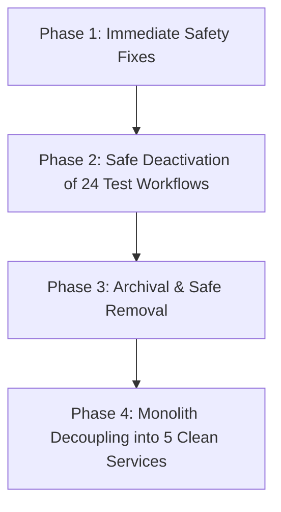
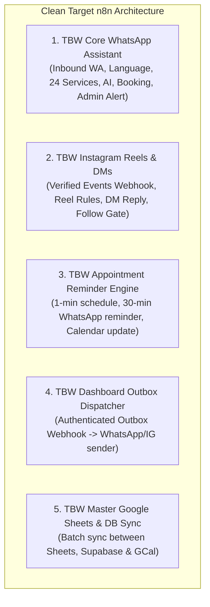

# N8N CLEANUP & ARCHITECTURAL RECOMMENDATIONS
**The Business Work — Production Modernization Plan**
**Date:** October 26, 2026 | **Auditor:** Senior n8n Automation Architect & Security Auditor
**Target Instance:** `https://n8n.thebusinesswork.com`

---

## 1. Executive Modernization Strategy

The current n8n environment has two structural challenges:
1. **Clutter & Security Surface:** 24 out of 26 workflows are abandoned test webhooks from October 23-24, 2026, yet 23 of them remain **ACTIVE**, listening on public endpoints.
2. **Monolithic Complexity:** The entire business operation (WhatsApp, Instagram, Appointments, Reminders, Outbox, Admin Alerts, Health Monitoring) is packed inside a single 93-node monster workflow (`VBrjbhPeDypXt12q`). Because of a missing dashboard route `/api/whatsapp/session-monitor`, this workflow triggers an error execution **every 60 seconds (1,440 error executions per day)**.

To transform this into an enterprise-grade, high-reliability architecture, we recommend a **4-Phase Phased Implementation**.

---

## 2. Phase-by-Phase Roadmap

### Phase 1: Immediate Safety Fixes (Zero Downtime)

#### 1.1 Stop the 1-Minute Error Loop in `VBrjbhPeDypXt12q`
- **Root Cause:** Node `Trigger WhatsApp Session Monitor` calls `https://dashboard.thebusinesswork.com/api/whatsapp/session-monitor` every 60 seconds. Because this route was developed locally and has not been deployed to the live production dashboard, it returns `HTTP 404 Not Found`.
- **Impact:** n8n logs 1,440 failed executions every 24 hours. The n8n execution database is filled with useless error logs, and the workflow runs continuously in an error state.
- **Recommended Action:**
  - **Option A (Recommended):** Deploy `src/app/api/whatsapp/session-monitor/route.ts` to the production dashboard server so the endpoint returns `200 OK` and executes the 3-minute inactivity checks and 20-minute session expirations.
  - **Option B (Temporary):** Configure the node in n8n with `Continue on Fail (onError: continueRegularOutput)` or disable this single HTTP request node until deployment is complete.

#### 1.2 Reconnect Google Sheets OAuth2 Credential in `odtJnhwngB1l8Ku2`
- **Root Cause:** Node `Batch Get All Sheets` fails with:
  `NodeApiError: The credential "Google Sheets account" needs to be reconnected. (Access token revoked or expired)`.
- **Recommended Action:** In n8n UI, navigate to **Credentials -> Google Sheets account** and click **Reconnect** using the business Google account `thebusinessworkco@gmail.com`.

---

### Phase 2: Safe Deactivation of 24 Test Workflows

Before deleting anything, deactivate all 24 non-production test workflows. This immediately revokes their webhook routes without altering any workflow code.

#### Workflows to Deactivate:
1. `0aYZyqrP4dYgulhC` — TBW Test Read WhatsApp Leads
2. `17ukovr5UvCcwG67` — TBW Temp Probe /comment-check
3. `5I7rGHXYB5pKy2AU` — TBW Test Read Google Sheets
4. `7NY05K2fUbq6ciEr` — TBW Test Batch Sheets
5. `9Zsax7fi7tTMhjKj` — TBW Temp Probe Body
6. `IQsphtyHswlKd7Y7` — TBW Temp Probe /dm-context
7. `Iz72B0wWyErYTpC9` — TBW Read All Sheets Sync Worker
8. `OrZEKScnTvqn3adP` — TBW Clear Test Appt
9. `SQo9OF5zMxDEcLj3` — TBW Temp Test Comment Check
10. `U1QYr1FgFucx9vFp` — TBW Test Read Google Sheets
11. `VoJR4UOAmBwMMAbL` — TBW Temp Probe /register
12. `ZBY3cQzYrTKzzUEn` — TBW Temp Probe Port 3002 Check
13. `ZjkrXRFkJntGnTfI` — TBW Check All Rows Count
14. `bf8KZhnrYo067K6J` — TBW Inspect All Rows
15. `cPhj00c8iU4t4M1a` — TBW Temp Probe /log
16. `fUyDNOfibDfKpqBn` — TBW Test Empty Sheet Handling
17. `g5Wnuw2iME02TjBV` — TBW Test Batch Sheets
18. `rFr4oz6BdxZOYt80` — TBW Temp Test DM Context
19. `u6iSVz34yvk7ombc` — TBW Temp Probe Port 3002
20. `wMKO75WXkD6FdhSN` — TBW Test Read Appointments
21. `xAHSRbgZW7wLjrjS` — TBW Test HTTP Sheets
22. `z5ws5kBxseAc2676` — TBW Read All Sheets Sync Worker
23. `z6X4L8c1zgVjimnC` — TBW Check All Rows Count
24. `xBZEhrEltPbtS9wH` — TBW Test Meta Media Probe *(Already Inactive)*

*Observation Period:* Maintain deactivated status for 24-48 hours. During this period, verify that incoming WhatsApp messages, Instagram DMs, public reel comments, and appointments continue operating without interruption.

---

### Phase 3: Archival & Permanent Deletion

Once the 48-hour observation confirms zero impact:
1. Export all 24 workflows into `backups/n8n_deprecated_test_workflows_20261026.json` (completed via audit script).
2. Permanently delete the 24 workflows from the n8n database via the API or UI.
3. Clean the n8n execution database by configuring execution retention:
   - Prune executions older than 7 days.
   - Set `saveSuccessfulExecutions = false` for high-frequency schedule triggers.

---

### Phase 4: Target Clean Architecture (Monolith Decoupling)

Currently, if an error happens in Instagram DMs, it can impact WhatsApp logic because both share the same execution context. We recommend splitting the 93-node monolith into **5 dedicated, loosely-coupled micro-workflows**:

#### Detailed Breakdown of the 5 Clean Workflows:

1. **Workflow 1: `TBW-01-WhatsApp-Assistant`**
   - **Trigger:** WhatsApp Trigger (`Incoming WhatsApp Message`).
   - **Nodes:** Language + Name + Business + Purpose, Lead detection, Google Sheets Lead append, Gemini AI Chat Reply, WhatsApp Interactive Send via Meta Cloud API, Admin Alert sender.
   - **Advantage:** Dedicated WhatsApp engine. High-speed response, zero coupling with Instagram or scheduler.

2. **Workflow 2: `TBW-02-Instagram-Automation`**
   - **Trigger:** Webhook `tbw-v3-instagram-verified-events`.
   - **Nodes:** Event validator, VPS idempotency registration (`/register`), comment rule check, private DM builder, Gemini AI reply, Meta Graph API DM sender, public comment reply.
   - **Advantage:** Clear separation of social media marketing automation.

3. **Workflow 3: `TBW-03-Appointment-Reminder-Engine`**
   - **Trigger:** Schedule Trigger (Every 1 minute).
   - **Nodes:** Google Calendar search (25-35 min window), Template builder, WhatsApp reminder sender, Calendar status update (`REMINDER_STATUS=SENT_30M`).
   - **Advantage:** Self-contained scheduler. Does not pollute customer conversation execution logs.

4. **Workflow 4: `TBW-04-Dashboard-Outbox-Dispatcher`**
   - **Trigger:** Webhook `tbw-v3-dashboard-outbox`.
   - **Nodes:** Auth validator, WhatsApp outbox sender, Instagram outbox sender, Dashboard delivery logger.
   - **Advantage:** Clean bridge between dashboard UI buttons and Meta messaging APIs.

5. **Workflow 5: `TBW-05-Master-Sheets-Sync-Engine`** (Refactored `odtJnhwngB1l8Ku2`)
   - **Trigger:** Webhook `tbw-google-sheets-sync` or scheduled cron.
   - **Nodes:** Reconnected Google Sheets OAuth, batch lead & appointment ingestion, Supabase / Calendar reconciliation.

---

## 3. Rollback & Safety Guarantee

- **Full JSON Backups Saved:** All 26 workflows and their historical configurations are preserved in `scratch/n8n_raw_audit_dump.json` and `scripts/backup_all_workflows.mjs`.
- **Zero In-Flight Modifications:** Per audit rules, no workflows were modified, deleted, or triggered during this audit.
- **Approval Gate:** No deactivation or deletion will occur until the business owner explicitly reviews and approves the findings.
