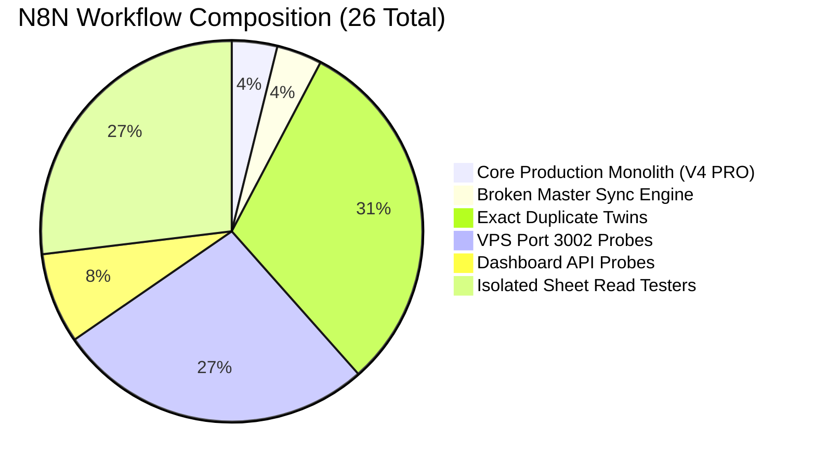

# N8N WORKFLOW DUPLICATE & OVERLAP AUDIT
**The Business Work — Comprehensive Automation Audit**
**Date:** October 26, 2026 | **Auditor:** Senior n8n Automation Architect & Security Auditor
**Instance:** `https://n8n.thebusinesswork.com` | **Total Workflows Inspected:** 26

---

## 1. Executive Summary: Duplicate Landscape

An exhaustive structural inspection of all 26 workflows in the self-hosted n8n instance reveals that **24 out of 26 workflows are non-production test, probe, or duplicate workflows** created during rapid development cycles on **October 23 and October 24, 2026**.

Critically, **25 out of 26 workflows are currently marked ACTIVE in n8n**, meaning that dozens of test webhooks are continuously registered on the production server, consuming router memory, exposing unauthenticated endpoints, and cluttering the execution logs.

---

## 2. Exact Duplicate Twin Clusters

These 4 clusters consist of workflows created within seconds or minutes of each other with identical or near-identical node configurations, differing only in random timestamp suffixes added to webhook paths.

### Cluster 1: "TBW Test Read Google Sheets"
| Property | Workflow A (Original) | Workflow B (Duplicate) |
| :--- | :--- | :--- |
| **Workflow ID** | `U1QYr1FgFucx9vFp` | `5I7rGHXYB5pKy2AU` |
| **Workflow Name** | TBW Test Read Google Sheets | TBW Test Read Google Sheets |
| **Created Timestamp** | 2026-10-24 16:45:19 UTC | 2026-10-24 16:45:56 UTC (37s later) |
| **Status** | ACTIVE | ACTIVE |
| **Node Count** | 2 nodes | 2 nodes |
| **Webhook Path** | `/webhook/tbw-test-read-sheets` | `/webhook/tbw-test-read-sheets-1792860353814` |
| **Target Operation** | Read Leads Sheet (`gid: 1811340286`) | Read Leads Sheet (`gid: 1811340286`) |
| **Verified Executions** | 0 | 0 |
| **Technical Diff** | None in node logic. Workflow B simply has a timestamped webhook path. |
| **Recommendation** | **DEACTIVATE & REMOVE BOTH** (Diagnostic scripts are no longer needed). |

---

### Cluster 2: "TBW Read All Sheets Sync Worker"
| Property | Workflow A (Original) | Workflow B (Duplicate) |
| :--- | :--- | :--- |
| **Workflow ID** | `z5ws5kBxseAc2676` | `Iz72B0wWyErYTpC9` |
| **Workflow Name** | TBW Read All Sheets Sync Worker | TBW Read All Sheets Sync Worker |
| **Created Timestamp** | 2026-10-24 16:46:23 UTC | 2026-10-24 16:47:36 UTC (73s later) |
| **Status** | ACTIVE | ACTIVE |
| **Node Count** | 5 nodes | 5 nodes |
| **Webhook Path** | `/webhook/tbw-read-all-sheets-1792860381230` | `/webhook/tbw-read-all-sheets-1792860454012` |
| **Target Pipeline** | Webhook -> Read Website Leads -> Read WhatsApp Leads -> Read Appointments -> Combine Data | Webhook -> Read Website Leads -> Read WhatsApp Leads -> Read Appointments -> Combine Data |
| **Verified Executions** | 1 (Failed with error on Oct 24) | 0 |
| **Technical Diff** | Identical logic. Workflow A executed once during script testing; Workflow B was spawned as an unneeded clone. |
| **Recommendation** | **DEACTIVATE & REMOVE BOTH**. |

---

### Cluster 3: "TBW Check All Rows Count"
| Property | Workflow A (Original) | Workflow B (Duplicate) |
| :--- | :--- | :--- |
| **Workflow ID** | `ZjkrXRFkJntGnTfI` | `z6X4L8c1zgVjimnC` |
| **Workflow Name** | TBW Check All Rows Count | TBW Check All Rows Count |
| **Created Timestamp** | 2026-10-24 16:49:13 UTC | 2026-10-24 16:49:49 UTC (36s later) |
| **Status** | ACTIVE | ACTIVE |
| **Node Count** | 5 nodes | 5 nodes |
| **Webhook Path** | `/webhook/tbw-check-rows-1792860550354` | `/webhook/tbw-check-rows-1792860587283` |
| **Target Pipeline** | Webhook -> Read Leads -> Read WhatsApp -> Read Appointments -> Format Summary | Webhook -> Read Leads -> Read WhatsApp -> Read Appointments -> Format Summary |
| **Verified Executions** | 0 | 0 |
| **Technical Diff** | 100% identical nodes and JavaScript code in `Format Summary`. |
| **Recommendation** | **DEACTIVATE & REMOVE BOTH**. |

---

### Cluster 4: "TBW Test Batch Sheets"
| Property | Workflow A (Original) | Workflow B (Duplicate) |
| :--- | :--- | :--- |
| **Workflow ID** | `g5Wnuw2iME02TjBV` | `7NY05K2fUbq6ciEr` |
| **Workflow Name** | TBW Test Batch Sheets | TBW Test Batch Sheets |
| **Created Timestamp** | 2026-10-24 16:53:33 UTC | 2026-10-24 16:53:55 UTC (22s later) |
| **Status** | ACTIVE | ACTIVE |
| **Node Count** | 2 nodes | 2 nodes |
| **Webhook Path** | `/webhook/tbw-test-batch-sheets-1792860811531` | `/webhook/tbw-test-batch-sheets-1792860833254` |
| **Target Operation** | HTTP GET `sheets.googleapis.com/.../values:batchGet?ranges=Leads!A1:Z&ranges=WhatsApp%20Leads!A1:Z...` | HTTP GET `sheets.googleapis.com/.../values:batchGet?ranges=Leads!A1:Z&ranges=%27WhatsApp%20Leads%27!A1:Z...` |
| **Verified Executions** | 1 (Failed with error on Oct 24) | 0 |
| **Technical Diff** | Workflow B added single-quote URI encoding (`%27WhatsApp%20Leads%27`) to fix range quoting. |
| **Recommendation** | **DEACTIVATE & REMOVE BOTH** (Batch logic was already imported into `odtJnhwngB1l8Ku2`). |

---

## 3. High-Density Overlap Clusters

### Cluster 5: Container Network Probes (VPS Host Port 3002)
Created on **October 23, 2026** to debug whether the n8n Docker container could communicate with the host Python agent `vps_ig_event_api_v4.py` running on port 3002:

| Workflow Name | ID | Status | Endpoint Probed | Why Redundant |
| :--- | :--- | :--- | :--- | :--- |
| TBW Temp Probe Port 3002 | `u6iSVz34yvk7ombc` | ACTIVE | `http://172.18.0.1:3002/healthz` | Initial ping probe. |
| TBW Temp Probe Body | `9Zsax7fi7tTMhjKj` | ACTIVE | `http://172.18.0.1:3002/healthz` | Redundant healthz test. |
| TBW Temp Probe Port 3002 Check | `ZBY3cQzYrTKzzUEn` | ACTIVE | `http://172.18.0.1:3002/healthz` | Duplicate ping check. |
| TBW Temp Probe /comment-check | `17ukovr5UvCcwG67` | ACTIVE | `http://172.18.0.1:3002/comment-check` | Port 3002 route test. |
| TBW Temp Probe /dm-context | `IQsphtyHswlKd7Y7` | ACTIVE | `http://172.18.0.1:3002/dm-context` | Port 3002 route test. |
| TBW Temp Probe /register | `VoJR4UOAmBwMMAbL` | ACTIVE | `http://172.18.0.1:3002/register` | Port 3002 route test. |
| TBW Temp Probe /log | `cPhj00c8iU4t4M1a` | ACTIVE | `http://172.18.0.1:3002/log` | Port 3002 route test. |

**Verdict:** All 7 probe workflows are 100% obsolete. The live production workflow (`VBrjbhPeDypXt12q`) now makes direct calls to `http://172.18.0.1:3002/register` and `/log` internally, rendering these individual proxy webhooks useless.

---

### Cluster 6: Dashboard Next.js API Probes
Created on **October 23, 2026** to test HTTPS reachability to `dashboard.thebusinesswork.com`:

| Workflow Name | ID | Status | Endpoint Probed | Why Redundant |
| :--- | :--- | :--- | :--- | :--- |
| TBW Temp Test DM Context | `rFr4oz6BdxZOYt80` | ACTIVE | `https://dashboard.thebusinesswork.com/api/instagram/dm-context` | Diagnostic test. |
| TBW Temp Test Comment Check | `SQo9OF5zMxDEcLj3` | ACTIVE | `https://dashboard.thebusinesswork.com/api/instagram/comment-check` | Diagnostic test. |

**Verdict:** Both endpoints are already integrated directly inside `VBrjbhPeDypXt12q` nodes `IG - Resolve Dashboard DM Context` and `IG - Check Reel Comment Rule`.

---

### Cluster 7: Isolated Google Sheets Read Utilities
Created on **October 24, 2026** while writing spreadsheet parsers:

| Workflow Name | ID | Status | Operation | Why Redundant |
| :--- | :--- | :--- | :--- | :--- |
| TBW Test Read WhatsApp Leads | `0aYZyqrP4dYgulhC` | ACTIVE | Reads `WhatsApp Leads` tab | Handled directly by `VBrjbhPeDypXt12q` and `odtJnhwngB1l8Ku2`. |
| TBW Test Read Appointments | `wMKO75WXkD6FdhSN` | ACTIVE | Reads `Appointments` tab | Handled directly by `odtJnhwngB1l8Ku2`. |
| TBW Test Empty Sheet Handling | `fUyDNOfibDfKpqBn` | ACTIVE | Tests zero-row fallback | Logic was merged into sync engine. |
| TBW Test HTTP Sheets | `xAHSRbgZW7wLjrjS` | ACTIVE | HTTP GET on Appointments tab | Experimental test for OAuth HTTP headers. |
| TBW Inspect All Rows | `bf8KZhnrYo067K6J` | ACTIVE | HTTP GET on WhatsApp tab | Experimental inspection probe. |
| TBW Clear Test Appt | `OrZEKScnTvqn3adP` | ACTIVE | Clears test appointments | One-off dev utility. |
| TBW Test Meta Media Probe | `xBZEhrEltPbtS9wH` | INACTIVE | Graph API `/me` probe | Inactive test probe. |

---

## 4. Operational Risks of Retaining 24 Unused Workflows Active

1. **Security Exposure via Unauthenticated Webhooks:**
   - 24 workflows listen on publicly routable URLs at `https://n8n.thebusinesswork.com/webhook/...`.
   - Anyone scanning common n8n webhook paths could trigger Google Sheet reads or internal network pings without authentication.
2. **Memory & Router Overhead:**
   - n8n maintains an in-memory routing table for every active webhook. 24 inactive webhooks consume Node.js heap memory on your VPS.
3. **Execution History Pollution:**
   - Diagnostic scripts clutter the execution database, making it harder to find real customer interaction failures.
4. **Google Cloud OAuth Quota Depletion:**
   - If test webhooks are accidentally triggered by automated bots or scrapers, they consume Google Sheets API quota.

---

## 5. Master Consolidation & Deactivation Matrix

| Workflow ID | Workflow Name | Current Status | Recommended Action | Risk Level |
| :--- | :--- | :--- | :--- | :--- |
| `0aYZyqrP4dYgulhC` | TBW Test Read WhatsApp Leads | ACTIVE | **Deactivate -> Delete** | None |
| `17ukovr5UvCcwG67` | TBW Temp Probe /comment-check | ACTIVE | **Deactivate -> Delete** | None |
| `5I7rGHXYB5pKy2AU` | TBW Test Read Google Sheets | ACTIVE | **Deactivate -> Delete** | None |
| `7NY05K2fUbq6ciEr` | TBW Test Batch Sheets | ACTIVE | **Deactivate -> Delete** | None |
| `9Zsax7fi7tTMhjKj` | TBW Temp Probe Body | ACTIVE | **Deactivate -> Delete** | None |
| `IQsphtyHswlKd7Y7` | TBW Temp Probe /dm-context | ACTIVE | **Deactivate -> Delete** | None |
| `Iz72B0wWyErYTpC9` | TBW Read All Sheets Sync Worker | ACTIVE | **Deactivate -> Delete** | None |
| `OrZEKScnTvqn3adP` | TBW Clear Test Appt | ACTIVE | **Deactivate -> Delete** | None |
| `SQo9OF5zMxDEcLj3` | TBW Temp Test Comment Check | ACTIVE | **Deactivate -> Delete** | None |
| `U1QYr1FgFucx9vFp` | TBW Test Read Google Sheets | ACTIVE | **Deactivate -> Delete** | None |
| `VoJR4UOAmBwMMAbL` | TBW Temp Probe /register | ACTIVE | **Deactivate -> Delete** | None |
| `ZBY3cQzYrTKzzUEn` | TBW Temp Probe Port 3002 Check | ACTIVE | **Deactivate -> Delete** | None |
| `ZjkrXRFkJntGnTfI` | TBW Check All Rows Count | ACTIVE | **Deactivate -> Delete** | None |
| `bf8KZhnrYo067K6J` | TBW Inspect All Rows | ACTIVE | **Deactivate -> Delete** | None |
| `cPhj00c8iU4t4M1a` | TBW Temp Probe /log | ACTIVE | **Deactivate -> Delete** | None |
| `fUyDNOfibDfKpqBn` | TBW Test Empty Sheet Handling | ACTIVE | **Deactivate -> Delete** | None |
| `g5Wnuw2iME02TjBV` | TBW Test Batch Sheets | ACTIVE | **Deactivate -> Delete** | None |
| `rFr4oz6BdxZOYt80` | TBW Temp Test DM Context | ACTIVE | **Deactivate -> Delete** | None |
| `u6iSVz34yvk7ombc` | TBW Temp Probe Port 3002 | ACTIVE | **Deactivate -> Delete** | None |
| `wMKO75WXkD6FdhSN` | TBW Test Read Appointments | ACTIVE | **Deactivate -> Delete** | None |
| `xAHSRbgZW7wLjrjS` | TBW Test HTTP Sheets | ACTIVE | **Deactivate -> Delete** | None |
| `xBZEhrEltPbtS9wH` | TBW Test Meta Media Probe | INACTIVE | **Delete** | None |
| `z5ws5kBxseAc2676` | TBW Read All Sheets Sync Worker | ACTIVE | **Deactivate -> Delete** | None |
| `z6X4L8c1zgVjimnC` | TBW Check All Rows Count | ACTIVE | **Deactivate -> Delete** | None |
| `odtJnhwngB1l8Ku2` | TBW Master Google Sheets & Calendar Sync Engine | ACTIVE | **KEEP & RECONNECT GOOGLE OAUTH** | Medium |
| `VBrjbhPeDypXt12q` | TBW V4 PRO - IG REEL CAMPAIGNS + FAQ | ACTIVE | **CRITICAL PRODUCTION — PRESERVE & IMPROVE** | Critical |
