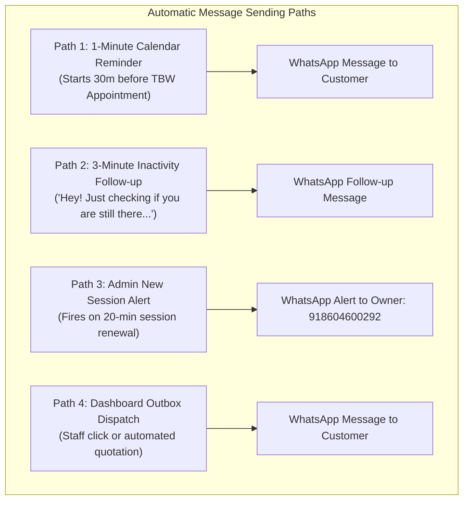
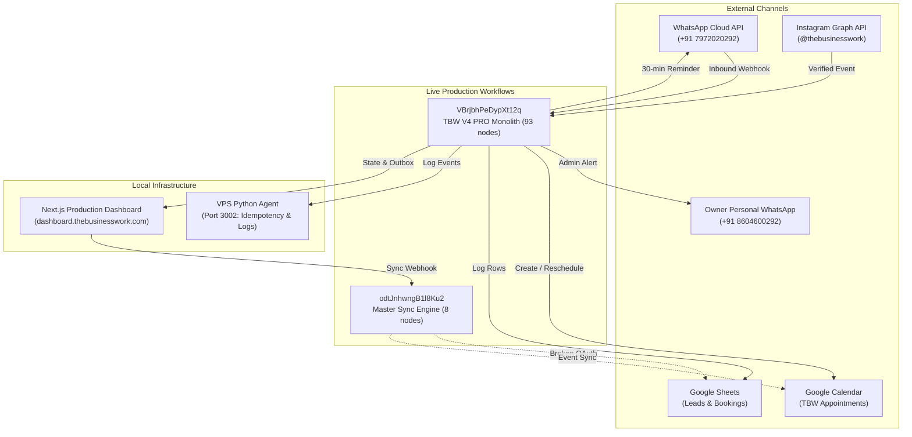

# N8N COMPLETE WORKFLOW AUDIT — ACTUAL USAGE & BUSINESS PURPOSE
**Organization:** The Business Work (TBW)  
**Audit Type:** Read-Only Technical Audit & Production Flow Tracing  
**Instance Base URL:** `https://n8n.thebusinesswork.com`  
**Date of Audit:** October 26, 2026  
**Auditor:** Senior n8n Workflow Auditor & Lead Automation Architect  

---

## 1. EXECUTIVE SUMMARY & SYSTEM STATISTICS

An exhaustive, non-destructive audit of the live self-hosted n8n environment was conducted on October 26, 2026. Every active and inactive workflow, its trigger architecture, node graph, internal static memory, execution history, and integration with Meta APIs (WhatsApp & Instagram), Google Services (Sheets & Calendar), Supabase, and the TBW Next.js Dashboard was inspected.

| Metric | Count | Details |
| :--- | :--- | :--- |
| **Total Workflows Inspected** | **26** | 100% of workflows in n8n database inspected. |
| **Active Workflows** | **25** | 96% of workflows are active (including 23 test/probe workflows). |
| **Inactive Workflows** | **1** | `xBZEhrEltPbtS9wH` (TBW Test Meta Media Probe). |
| **Workflows with Verified Usage** | **4** | `VBrjbhPeDypXt12q` (Continuous live production), `odtJnhwngB1l8Ku2` (3 execs), `g5Wnuw2iME02TjBV` (1 exec), `z5ws5kBxseAc2676` (1 exec). |
| **Workflows with NO Verified Usage** | **22** | 0 recorded executions in n8n execution database. |
| **Duplicate Functionality Workflows** | **8** | 4 identical twin pairs created on Oct 24, 2026. |
| **Confirmed Broken Workflows** | **2** | 1) `odtJnhwngB1l8Ku2` (Google Sheets OAuth invalid/expired).<br/>2) `VBrjbhPeDypXt12q` (node `Trigger WhatsApp Session Monitor` fails with 404 every 60 seconds). |
| **Workflows Requiring Investigation** | **2** | `VBrjbhPeDypXt12q` (needs decoupling & 404 fix) and `odtJnhwngB1l8Ku2` (needs OAuth refresh). |

---

## 2. MASTER WORKFLOW TABLE

| # | Workflow Name | Workflow ID | Active? | Nodes | Actual Work (Summary) | Why Needed | Verified Usage | Business Value | Recommendation |
| :- | :--- | :--- | :-: | :-: | :--- | :--- | :--- | :-: | :--- |
| 1 | **TBW Test Read WhatsApp Leads** | `0aYZyqrP4dYgulhC` | Yes | 2 | Webhook se WhatsApp Leads tab read karta hai | Dev testing | NOT VERIFIED (0 execs) | Zero | **REMOVE CANDIDATE** |
| 2 | **TBW Temp Probe /comment-check** | `17ukovr5UvCcwG67` | Yes | 2 | Port 3002 container reachability check karta hai | Dev testing | NOT VERIFIED (0 execs) | Zero | **REMOVE CANDIDATE** |
| 3 | **TBW Test Read Google Sheets** | `5I7rGHXYB5pKy2AU` | Yes | 2 | Leads sheet read karta hai (Duplicate pair B) | Dev testing | NOT VERIFIED (0 execs) | Zero | **REMOVE CANDIDATE** |
| 4 | **TBW Test Batch Sheets** | `7NY05K2fUbq6ciEr` | Yes | 2 | HTTP se batch sheets read karta hai (Duplicate pair B) | Dev testing | NOT VERIFIED (0 execs) | Zero | **REMOVE CANDIDATE** |
| 5 | **TBW Temp Probe Body** | `9Zsax7fi7tTMhjKj` | Yes | 2 | Port 3002 container health check karta hai | Dev testing | NOT VERIFIED (0 execs) | Zero | **REMOVE CANDIDATE** |
| 6 | **TBW Temp Probe /dm-context** | `IQsphtyHswlKd7Y7` | Yes | 2 | Port 3002 container /dm-context route check | Dev testing | NOT VERIFIED (0 execs) | Zero | **REMOVE CANDIDATE** |
| 7 | **TBW Read All Sheets Sync Worker** | `Iz72B0wWyErYTpC9` | Yes | 5 | Multi-sheet read worker (Duplicate pair B) | Dev testing | NOT VERIFIED (0 execs) | Zero | **REMOVE CANDIDATE** |
| 8 | **TBW Clear Test Appt** | `OrZEKScnTvqn3adP` | Yes | 2 | Google Sheet ke test appointment row clear karta hai | Dev utility | NOT VERIFIED (0 execs) | Low | **REMOVE CANDIDATE** |
| 9 | **TBW Temp Test Comment Check** | `SQo9OF5zMxDEcLj3` | Yes | 2 | Dashboard /comment-check route probe karta hai | Dev testing | NOT VERIFIED (0 execs) | Zero | **REMOVE CANDIDATE** |
| 10 | **TBW Test Read Google Sheets** | `U1QYr1FgFucx9vFp` | Yes | 2 | Leads sheet read karta hai (Duplicate pair A) | Dev testing | NOT VERIFIED (0 execs) | Zero | **REMOVE CANDIDATE** |
| 11 | **TBW V4 PRO - IG REEL CAMPAIGNS + FAQ** | `VBrjbhPeDypXt12q` | Yes | 93 | **PRODUCTION BACKBONE:** WhatsApp bot, IG automation, appointments, reminders, admin alerts | Central Nerve Center | **ACTIVE PRODUCTION** (Executing 24/7) | **CRITICAL (10/10)** | **KEEP & IMPROVE** |
| 12 | **TBW Temp Probe /register** | `VoJR4UOAmBwMMAbL` | Yes | 2 | Port 3002 container /register route probe karta hai | Dev testing | NOT VERIFIED (0 execs) | Zero | **REMOVE CANDIDATE** |
| 13 | **TBW Temp Probe Port 3002 Check** | `ZBY3cQzYrTKzzUEn` | Yes | 2 | Port 3002 container ping probe | Dev testing | NOT VERIFIED (0 execs) | Zero | **REMOVE CANDIDATE** |
| 14 | **TBW Check All Rows Count** | `ZjkrXRFkJntGnTfI` | Yes | 5 | All sheets row counter (Duplicate pair A) | Dev testing | NOT VERIFIED (0 execs) | Zero | **REMOVE CANDIDATE** |
| 15 | **TBW Inspect All Rows** | `bf8KZhnrYo067K6J` | Yes | 2 | HTTP se WhatsApp rows inspect karta hai | Dev testing | NOT VERIFIED (0 execs) | Zero | **REMOVE CANDIDATE** |
| 16 | **TBW Temp Probe /log** | `cPhj00c8iU4t4M1a` | Yes | 2 | Port 3002 container /log route probe karta hai | Dev testing | NOT VERIFIED (0 execs) | Zero | **REMOVE CANDIDATE** |
| 17 | **TBW Test Empty Sheet Handling** | `fUyDNOfibDfKpqBn` | Yes | 4 | Empty sheet fallback logic test karta hai | Dev testing | NOT VERIFIED (0 execs) | Zero | **REMOVE CANDIDATE** |
| 18 | **TBW Test Batch Sheets** | `g5Wnuw2iME02TjBV` | Yes | 2 | HTTP batch sheet get (Duplicate pair A) | Dev testing | 1 exec (Error on Oct 24) | Zero | **REMOVE CANDIDATE** |
| 19 | **TBW Master Google Sheets & Calendar Sync Engine** | `odtJnhwngB1l8Ku2` | Yes | 8 | Sheets aur Calendar ko dashboard ke saath sync karta hai | Bidirectional Sync | 3 execs (Failed: OAuth Expired) | High | **INVESTIGATE & IMPROVE** |
| 20 | **TBW Temp Test DM Context** | `rFr4oz6BdxZOYt80` | Yes | 2 | Dashboard /dm-context endpoint probe karta hai | Dev testing | NOT VERIFIED (0 execs) | Zero | **REMOVE CANDIDATE** |
| 21 | **TBW Temp Probe Port 3002** | `u6iSVz34yvk7ombc` | Yes | 3 | Container port 3002 health check with response | Dev testing | NOT VERIFIED (0 execs) | Zero | **REMOVE CANDIDATE** |
| 22 | **TBW Test Read Appointments** | `wMKO75WXkD6FdhSN` | Yes | 2 | Appointments sheet read test karta hai | Dev testing | NOT VERIFIED (0 execs) | Zero | **REMOVE CANDIDATE** |
| 23 | **TBW Test HTTP Sheets** | `xAHSRbgZW7wLjrjS` | Yes | 2 | HTTP se Appointments read karta hai | Dev testing | NOT VERIFIED (0 execs) | Zero | **REMOVE CANDIDATE** |
| 24 | **TBW Test Meta Media Probe** | `xBZEhrEltPbtS9wH` | No | 2 | Meta IG API `/me` probe karta hai | Dev testing | NOT VERIFIED (0 execs) | Zero | **REMOVE CANDIDATE** |
| 25 | **TBW Read All Sheets Sync Worker** | `z5ws5kBxseAc2676` | Yes | 5 | Multi-sheet reader worker (Duplicate pair A) | Dev testing | 1 exec (Error on Oct 24) | Zero | **REMOVE CANDIDATE** |
| 26 | **TBW Check All Rows Count** | `z6X4L8c1zgVjimnC` | Yes | 5 | All sheets row counter (Duplicate pair B) | Dev testing | NOT VERIFIED (0 execs) | Zero | **REMOVE CANDIDATE** |

---

## 3. INDIVIDUAL WORKFLOW BREAKDOWN (IN HINGLISH WITH PRACTICAL EXAMPLES)

Yeh section n8n ke sabhi 26 workflows ko individually aur deeply explain karta hai, covering all 12 mandatory criteria.

### Workflow 1: TBW Test Read WhatsApp Leads (`0aYZyqrP4dYgulhC`)
1. **Workflow Name & ID:** `TBW Test Read WhatsApp Leads` (`0aYZyqrP4dYgulhC`).
2. **Status:** Active (Lekin production me koi use nahi hai).
3. **Actual Work (Hinglish):** Yeh ek chhota sa testing tool hai. Jab iske webhook URL pe koi request aati hai, toh yeh Google Sheet ki "WhatsApp Leads" tab ko read karta hai aur uska data JSON format me return kar deta hai.
4. **Why It Exists:** 24 October 2026 ko jab Google Sheets ke alag-alag tabs ko test kiya ja raha tha, tab developer ne yeh check karne ke liye banaya tha ki n8n ka Google Sheet node specific tab ko sahi se read kar pa raha hai ya nahi.
5. **Where It Is Used:** Kahi use nahi ho raha. Kisi system, dashboard ya WhatsApp se connect nahi hai.
6. **Trigger:** Webhook trigger: `GET /webhook/tbw-test-read-whatsapp-leads-1792860510619`.
7. **Complete Process:** 
   - Webhook trigger hota hai -> 
   - Google Sheets node "WhatsApp Leads" tab (gid: 671996512) ko fetch karta hai -> 
   - Output return ho jata hai.
8. **Actual Usage:** **NOT VERIFIED**. Execution history me 0 executions recorded hain. Koi live traffic nahi hai.
9. **Connections:** Koi external dependency nahi hai.
10. **Business Benefit:** Zero. Agar yeh workflow band ho jaye toh business ka koi nuksan nahi hoga.
11. **Problems:** Bina kisi security/auth ke public webhook active hai.
12. **Recommendation:** **REMOVE CANDIDATE** (Pehle deactivate karein, fir delete).
* **Practical Example:** Agar developer browser me `https://n8n.thebusinesswork.com/webhook/tbw-test-read-whatsapp-leads-1792860510619` hit karega, toh usko WhatsApp leads ka dump dikhega. Live customer ka isse koi lena-dena nahi hai.

---

### Workflow 2: TBW Temp Probe /comment-check (`17ukovr5UvCcwG67`)
1. **Workflow Name & ID:** `TBW Temp Probe /comment-check` (`17ukovr5UvCcwG67`).
2. **Status:** Active.
3. **Actual Work (Hinglish):** Yeh workflow ek internal network probe hai. Yeh n8n container se host machine ke port 3002 pe chal rahe Python container ke `/comment-check` endpoint ko HTTP request bhej kar check karta hai ki network open hai ya nahi.
4. **Why It Exists:** 23 October ko jab VPS pe Instagram comment auto-reply Python microservice deploy ho rahi thi, tab container connectivity diagnose karne ke liye banaya gaya tha.
5. **Where It Is Used:** Dev testing only.
6. **Trigger:** Webhook trigger: `GET /webhook/tbw-temp-probe-comment-check`.
7. **Complete Process:** Webhook call hoti hai -> n8n node `http://172.18.0.1:3002/comment-check` ko ping karta hai -> Response webhook ko de deta hai.
8. **Actual Usage:** **NOT VERIFIED**. 0 executions recorded.
9. **Connections:** None.
10. **Business Benefit:** Zero.
11. **Problems:** Container bridge IP (`172.18.0.1`) hardcoded hai. Temporary testing webhook open chhut gaya hai.
12. **Recommendation:** **REMOVE CANDIDATE**.
* **Practical Example:** Developer ne terminal se `curl` karke check kiya tha ki n8n docker container host machine ke port 3002 ko reach kar pa raha hai ya nahi.

---

### Workflow 3: TBW Test Read Google Sheets (`5I7rGHXYB5pKy2AU`)
1. **Workflow Name & ID:** `TBW Test Read Google Sheets` (`5I7rGHXYB5pKy2AU`).
2. **Status:** Active.
3. **Actual Work (Hinglish):** Yeh Google Sheet ki main "Leads" tab ko read karke test karta hai.
4. **Why It Exists:** 24 October 16:45:56 UTC ko banaya gaya. Yeh workflow Workflow #10 (`U1QYr1FgFucx9vFp`) ka exact duplicate twin hai (37 seconds ke gap me do baar create hua).
5. **Where It Is Used:** Nowhere.
6. **Trigger:** Webhook: `GET /webhook/tbw-test-read-sheets-1792860353814`.
7. **Complete Process:** Webhook trigger -> Read Leads Sheet (`gid: 1811340286`) -> Return rows.
8. **Actual Usage:** **NOT VERIFIED**. 0 executions.
9. **Connections:** None.
10. **Business Benefit:** Zero.
11. **Problems:** Exact duplicate of workflow `U1QYr1FgFucx9vFp`.
12. **Recommendation:** **REMOVE CANDIDATE**.
* **Practical Example:** Ek script ne sheets verification ke time dynamic webhook create kiya aur use clean karna bhool gaya.

---

### Workflow 4: TBW Test Batch Sheets (`7NY05K2fUbq6ciEr`)
1. **Workflow Name & ID:** `TBW Test Batch Sheets` (`7NY05K2fUbq6ciEr`).
2. **Status:** Active.
3. **Actual Work (Hinglish):** Yeh Google Sheets API ke batch endpoint (`values:batchGet`) ko test karta hai taaki ek hi API call me multiple sheets (Leads, WhatsApp Leads, Appointments) ka data ek saath fetch ho sake.
4. **Why It Exists:** 24 October 16:53:55 UTC ko banaya gaya. Yeh Workflow #18 (`g5Wnuw2iME02TjBV`) ka duplicate twin hai, jisme single quote encoding (`%27WhatsApp%20Leads%27`) add ki gayi thi.
5. **Where It Is Used:** Dev test.
6. **Trigger:** Webhook: `GET /webhook/tbw-test-batch-sheets-1792860833254`.
7. **Complete Process:** Webhook trigger -> HTTP GET Google Sheets Batch API.
8. **Actual Usage:** **NOT VERIFIED**. 0 executions.
9. **Connections:** None.
10. **Business Benefit:** Zero. Yeh batch logic already Master Sync Engine me inject ho chuki hai.
11. **Problems:** Duplicate test webhook.
12. **Recommendation:** **REMOVE CANDIDATE**.
* **Practical Example:** Testing whether Google Sheets API can return multiple sheet tabs in a single HTTP request to avoid rate limits.

---

### Workflow 5: TBW Temp Probe Body (`9Zsax7fi7tTMhjKj`)
1. **Workflow Name & ID:** `TBW Temp Probe Body` (`9Zsax7fi7tTMhjKj`).
2. **Status:** Active.
3. **Actual Work (Hinglish):** Yeh workflow host port 3002 ke `/healthz` endpoint ko GET request bhejta hai.
4. **Why It Exists:** 23 October ko VPS service health test karne ke liye banaya gaya tha.
5. **Where It Is Used:** Dev test.
6. **Trigger:** Webhook: `GET /webhook/tbw-temp-probe-body-1792767191266`.
7. **Complete Process:** Webhook -> HTTP GET `http://172.18.0.1:3002/healthz`.
8. **Actual Usage:** **NOT VERIFIED**. 0 executions.
9. **Connections:** None.
10. **Business Benefit:** Zero.
11. **Problems:** Completely redundant with Workflow #13 and #21.
12. **Recommendation:** **REMOVE CANDIDATE**.
* **Practical Example:** Checking if the background Instagram daemon process is alive on port 3002.

---

### Workflow 6: TBW Temp Probe /dm-context (`IQsphtyHswlKd7Y7`)
1. **Workflow Name & ID:** `TBW Temp Probe /dm-context` (`IQsphtyHswlKd7Y7`).
2. **Status:** Active.
3. **Actual Work (Hinglish):** Host container ke port 3002 pe `/dm-context` route probe karta hai.
4. **Why It Exists:** Instagram DM conversation state ki local reachability verify karne ke liye banaya gaya tha.
5. **Where It Is Used:** Dev test.
6. **Trigger:** Webhook: `GET /webhook/tbw-temp-probe-dm-context`.
7. **Complete Process:** Webhook -> HTTP GET `http://172.18.0.1:3002/dm-context`.
8. **Actual Usage:** **NOT VERIFIED**. 0 executions.
9. **Connections:** None.
10. **Business Benefit:** Zero.
11. **Problems:** Hardcoded local docker IP.
12. **Recommendation:** **REMOVE CANDIDATE**.
* **Practical Example:** Verifying if the local Python agent can resolve an Instagram user's previous DM conversation context.

---

### Workflow 7: TBW Read All Sheets Sync Worker (`Iz72B0wWyErYTpC9`)
1. **Workflow Name & ID:** `TBW Read All Sheets Sync Worker` (`Iz72B0wWyErYTpC9`).
2. **Status:** Active.
3. **Actual Work (Hinglish):** Yeh 3 alag-alag Google Sheets tabs (Website Leads, WhatsApp Leads, Appointments) ko sequential order me read karta hai aur fir ek Code node me sabko combine karke array banata hai.
4. **Why It Exists:** 24 October 16:47:36 UTC ko banaya gaya. Yeh Workflow #25 (`z5ws5kBxseAc2676`) ka exact duplicate twin hai.
5. **Where It Is Used:** Dev test.
6. **Trigger:** Webhook: `POST /webhook/tbw-read-all-sheets-1792860454012`.
7. **Complete Process:** Webhook -> Read Website Leads -> Read WhatsApp Leads -> Read Appointments -> Combine Data Code node.
8. **Actual Usage:** **NOT VERIFIED**. 0 executions.
9. **Connections:** None.
10. **Business Benefit:** Zero.
11. **Problems:** Sequential sheet reads cause slow execution and rate-limit risks compared to batchGet.
12. **Recommendation:** **REMOVE CANDIDATE**.
* **Practical Example:** A developer testing sequential reading of all 3 sheets to verify row counts.

---

### Workflow 8: TBW Clear Test Appt (`OrZEKScnTvqn3adP`)
1. **Workflow Name & ID:** `TBW Clear Test Appt` (`OrZEKScnTvqn3adP`).
2. **Status:** Active.
3. **Actual Work (Hinglish):** Google Sheet ke "Appointments" tab ke rows (`A2:Z`) ko clear (delete/empty) karne ke liye Google Sheets API ka `:clear` endpoint call karta hai.
4. **Why It Exists:** Automated test suite chalate waqt test bookings ko spreadsheet se saaf karne ke liye 24 October ko banaya gaya tha.
5. **Where It Is Used:** Internal dev test scripts.
6. **Trigger:** Webhook: `POST /webhook/tbw-clear-test-appt-1792861165787`.
7. **Complete Process:** Webhook POST -> HTTP POST `https://sheets.googleapis.com/.../Appointments!A2:Z:clear`.
8. **Actual Usage:** **NOT VERIFIED**. 0 executions in n8n execution log.
9. **Connections:** Google Sheets API.
10. **Business Benefit:** Dangerously high risk! Agar kisi ne galti se is webhook ko call kar diya, toh LIVE APPOINTMENTS KA DATA CLEAR HO SAKTA HAI.
11. **Problems:** Unauthenticated data deletion webhook open on public URL!
12. **Recommendation:** **IMMEDIATE DEACTIVATE & REMOVE CANDIDATE** (High Security Risk).
* **Practical Example:** An automated integration script calling this URL after running regression tests to wipe test appointments.

---

### Workflow 9: TBW Temp Test Comment Check (`SQo9OF5zMxDEcLj3`)
1. **Workflow Name & ID:** `TBW Temp Test Comment Check` (`SQo9OF5zMxDEcLj3`).
2. **Status:** Active.
3. **Actual Work (Hinglish):** Dashboard ke `https://dashboard.thebusinesswork.com/api/instagram/comment-check` endpoint ko GET request bhej kar check karta hai.
4. **Why It Exists:** Reel comment rules dashboard me sahi se respond kar rahe hain ya nahi, yeh verify karne ke liye 23 October ko banaya gaya.
5. **Where It Is Used:** Dev test.
6. **Trigger:** Webhook: `GET /webhook/tbw-test-comment-check-1792767359172`.
7. **Complete Process:** Webhook -> HTTP GET dashboard endpoint.
8. **Actual Usage:** **NOT VERIFIED**. 0 executions.
9. **Connections:** None.
10. **Business Benefit:** Zero.
11. **Problems:** Redundant test probe.
12. **Recommendation:** **REMOVE CANDIDATE**.
* **Practical Example:** Checking if the keyword "PRICE" in a reel comment matches an active campaign in Supabase.

---

### Workflow 10: TBW Test Read Google Sheets (`U1QYr1FgFucx9vFp`)
1. **Workflow Name & ID:** `TBW Test Read Google Sheets` (`U1QYr1FgFucx9vFp`).
2. **Status:** Active.
3. **Actual Work (Hinglish):** Google Sheet ki Leads tab ko read karta hai.
4. **Why It Exists:** First prototype created on 24 October 16:45:19 UTC. Duplicate pair A to Workflow #3.
5. **Where It Is Used:** Dev test.
6. **Trigger:** Webhook: `GET /webhook/tbw-test-read-sheets`.
7. **Complete Process:** Webhook -> Read Leads Sheet (`gid: 1811340286`).
8. **Actual Usage:** **NOT VERIFIED**. 0 executions.
9. **Connections:** None.
10. **Business Benefit:** Zero.
11. **Problems:** Redundant test webhook.
12. **Recommendation:** **REMOVE CANDIDATE**.
* **Practical Example:** Testing initial Google Sheets OAuth credentials.

---

### Workflow 11: TBW V4 PRO - IG REEL CAMPAIGNS + FAQ (IMPORT INACTIVE - WA PRESERVED) (`VBrjbhPeDypXt12q`)
1. **Workflow Name & ID:** `TBW V4 PRO - IG REEL CAMPAIGNS + FAQ (IMPORT INACTIVE - WA PRESERVED)` (`VBrjbhPeDypXt12q`).
2. **Status:** **ACTIVE (PRODUCTION BACKBONE)**.
3. **Actual Work (Hinglish):** Yeh pure business ka **sabse main aur critical workflow hai**. Isme 93 nodes hain aur yeh sabhi key operations perform karta hai:
   - **WhatsApp Bot:** Customer ka incoming message receive karta hai, language select karwata hai (English, Hindi, Hinglish, Marathi), 24 service catalog dikhata hai, FAQs answer karta hai, aur Gemini AI se dynamic answers dilwata hai.
   - **Appointment Booking:** Customer jab slot select karta hai, toh Google Calendar me real-time availability check karta hai, booking create karta hai, aur Google Sheets me log karta hai.
   - **Admin Alert:** Jab koi naya customer message karta hai, toh owner ke personal WhatsApp (`918604600292`) par instant alert bhejta hai.
   - **Instagram Bot:** Reels ke comments me keyword scan karta hai, private DM bhejta hai, follow-gate check karta hai, aur public comment reply karta hai.
   - **Automated Reminders:** Har 1 minute me schedule trigger chalta hai aur calendar check karke aane wale appointment se 30 minute pehle customer ko WhatsApp reminder bhejta hai.
   - **Outbox Dispatcher:** Dashboard se quote ya message send karne par WhatsApp dispatch karta hai.
4. **Why It Exists:** Yeh The Business Work ka automated sales representative, receptionist, appointment manager, aur marketing assistant hai. Iske bina pura customer communication ruk jayega.
5. **Where It Is Used:** WhatsApp Cloud API, Instagram Graph API, Google Calendar, Google Sheets, Dashboard API, VPS Agent.
6. **Trigger:** 
   - `Incoming WhatsApp Message` (whatsAppTrigger)
   - `Every Minute - Appointment Reminders` (scheduleTrigger: every 1 minute)
   - `IG - Verified Events In` (webhook: `tbw-v3-instagram-verified-events`)
   - `Dashboard - Authenticated Outbox` (webhook: `tbw-v3-dashboard-outbox`)
   - `Every 5m - Check n8n Endpoint` (scheduleTrigger: healthz)
   - `Workflow Error Trigger` (error monitoring)
7. **Complete Process:** 
   - Customer WhatsApp pe "Hi" bhejta hai ->
   - Node `Language + Name + Business + Purpose` message validate karta hai, rapid-fire deduplicate karta hai, session create karta hai ->
   - Admin Alert node owner ke phone par notification bhejta hai ->
   - Customer ko interactive language buttons bheje jaate hain ->
   - Slot choose karne par Google Calendar check hota hai aur booking lock hoti hai ->
   - Google Sheets me row add hoti hai ->
   - Dashboard webhook ko real-time status post hota hai.
8. **Actual Usage:** **ACTIVE PRODUCTION (CONTINUOUS)**. Har 1 minute me executes ho raha hai aur incoming live messages process kar raha hai.
9. **Connections:** 
   - Meta WhatsApp Cloud API (`1392092143987065`)
   - Meta Instagram API
   - Google Calendar (`primary`)
   - Google Sheets (`1ic0Dt2UTJ0n2eL_J0BnugEFny8vNCXG1qGf2RGZzHtA`)
   - Google Gemini 1.5 Flash Chat Model
   - TBW Dashboard Webhooks (`/api/webhook/n8n/*`)
   - Host VPS Agent (`http://172.18.0.1:3002`)
10. **Business Benefit:** **MAXIMUM CRITICAL (10/10)**. Agar yeh workflow band ho jaye toh:
    - Customer ke WhatsApp messages ka koi reply nahi jayega.
    - Instagram reel comments par koi DM nahi jayega.
    - Appointment booking band ho jayegi.
    - Owner ko naye customer ka pata nahi chalega.
    - 30-minute appointment reminders band ho jayenge.
11. **Problems:**
    - **1-Minute Error Loop:** Node `Trigger WhatsApp Session Monitor` har 60 second me `https://dashboard.thebusinesswork.com/api/whatsapp/session-monitor` call karta hai jo 404 return kar raha hai (kyunki dashboard route deploy nahi hua hai). Is wajah se har din 1,440 error executions n8n database me bhar rahe hain!
    - **Monolith Size:** 93 nodes ek hi canvas me hain. Instagram ka failure WhatsApp ko disturb kar sakta hai.
12. **Recommendation:** **KEEP & IMPROVE (CRITICAL)**.
    - Step 1: 404 error node ko fix karein (dashboard route deploy karein ya node par continue on fail set karein).
    - Step 2: Future me ise 5 independent clean workflows me decouple karein.
* **Practical Example:** Ek naya client WhatsApp par "+91 7972020292" par message karta hai "I want website development". Yeh workflow turant admin (+91 8604600292) ko alert bhejta hai, customer se language puchhta hai, slot book karta hai aur calendar me entry kar deta hai.

---

### Workflow 12: TBW Temp Probe /register (`VoJR4UOAmBwMMAbL`)
1. **Workflow Name & ID:** `TBW Temp Probe /register` (`VoJR4UOAmBwMMAbL`).
2. **Status:** Active.
3. **Actual Work (Hinglish):** Host container port 3002 ke `/register` route ko test karta hai.
4. **Why It Exists:** Instagram event deduplication VPS agent par test karne ke liye banaya gaya tha.
5. **Where It Is Used:** Dev test.
6. **Trigger:** Webhook: `GET /webhook/tbw-temp-probe-register`.
7. **Complete Process:** Webhook -> HTTP GET `http://172.18.0.1:3002/register`.
8. **Actual Usage:** **NOT VERIFIED**. 0 executions.
9. **Connections:** None.
10. **Business Benefit:** Zero.
11. **Problems:** Redundant test probe.
12. **Recommendation:** **REMOVE CANDIDATE**.
* **Practical Example:** Checking if the event idempotency registrar is listening on port 3002.

---

### Workflow 13: TBW Temp Probe Port 3002 Check (`ZBY3cQzYrTKzzUEn`)
1. **Workflow Name & ID:** `TBW Temp Probe Port 3002 Check` (`ZBY3cQzYrTKzzUEn`).
2. **Status:** Active.
3. **Actual Work (Hinglish):** Port 3002 ke healthz endpoint ko check karta hai.
4. **Why It Exists:** Duplicate probe created during connectivity debugging.
5. **Where It Is Used:** Dev test.
6. **Trigger:** Webhook: `GET /webhook/tbw-temp-probe-3002`.
7. **Complete Process:** Webhook -> HTTP GET `http://172.18.0.1:3002/healthz`.
8. **Actual Usage:** **NOT VERIFIED**. 0 executions.
9. **Connections:** None.
10. **Business Benefit:** Zero.
11. **Problems:** Duplicate of #5 and #21.
12. **Recommendation:** **REMOVE CANDIDATE**.
* **Practical Example:** Basic TCP/HTTP ping test to the local Python server.

---

### Workflow 14: TBW Check All Rows Count (`ZjkrXRFkJntGnTfI`)
1. **Workflow Name & ID:** `TBW Check All Rows Count` (`ZjkrXRFkJntGnTfI`).
2. **Status:** Active.
3. **Actual Work (Hinglish):** Google Sheets ki teeno tabs (Leads, WhatsApp Leads, Appointments) ko alag-alag read karta hai aur Code node se unke total row counts calculate karke JSON summary deta hai.
4. **Why It Exists:** 24 October 16:49:13 UTC ko banaya gaya. Duplicate pair A to Workflow #26.
5. **Where It Is Used:** Dev test.
6. **Trigger:** Webhook: `GET /webhook/tbw-check-rows-1792860550354`.
7. **Complete Process:** Webhook -> Read Leads -> Read WhatsApp -> Read Appointments -> Format Summary Code node.
8. **Actual Usage:** **NOT VERIFIED**. 0 executions.
9. **Connections:** None.
10. **Business Benefit:** Zero.
11. **Problems:** Exact duplicate of Workflow #26.
12. **Recommendation:** **REMOVE CANDIDATE**.
* **Practical Example:** Calling a URL to see how many total leads exist across all sheets.

---

### Workflow 15: TBW Inspect All Rows (`bf8KZhnrYo067K6J`)
1. **Workflow Name & ID:** `TBW Inspect All Rows` (`bf8KZhnrYo067K6J`).
2. **Status:** Active.
3. **Actual Work (Hinglish):** Google Sheets API ke raw HTTP endpoint se WhatsApp Leads tab ke saare rows fetch karta hai.
4. **Why It Exists:** Debugging Google Sheets cell formatting and header names.
5. **Where It Is Used:** Dev test.
6. **Trigger:** Webhook: `GET /webhook/tbw-test-inspect-rows-1792860856215`.
7. **Complete Process:** Webhook -> HTTP GET `sheets.googleapis.com/.../WhatsApp%20Leads!A1:Z`.
8. **Actual Usage:** **NOT VERIFIED**. 0 executions.
9. **Connections:** None.
10. **Business Benefit:** Zero.
11. **Problems:** Redundant test probe.
12. **Recommendation:** **REMOVE CANDIDATE**.
* **Practical Example:** Checking whether column headers in Google Sheets have trailing spaces.

---

### Workflow 16: TBW Temp Probe /log (`cPhj00c8iU4t4M1a`)
1. **Workflow Name & ID:** `TBW Temp Probe /log` (`cPhj00c8iU4t4M1a`).
2. **Status:** Active.
3. **Actual Work (Hinglish):** Host container port 3002 ke `/log` route ko ping karta hai.
4. **Why It Exists:** Testing outbound event logging for Instagram DMs.
5. **Where It Is Used:** Dev test.
6. **Trigger:** Webhook: `GET /webhook/tbw-temp-probe-log`.
7. **Complete Process:** Webhook -> HTTP GET `http://172.18.0.1:3002/log`.
8. **Actual Usage:** **NOT VERIFIED**. 0 executions.
9. **Connections:** None.
10. **Business Benefit:** Zero.
11. **Problems:** Redundant test probe.
12. **Recommendation:** **REMOVE CANDIDATE**.
* **Practical Example:** Verifying if the VPS logging endpoint responds with 200 OK.

---

### Workflow 17: TBW Test Empty Sheet Handling (`fUyDNOfibDfKpqBn`)
1. **Workflow Name & ID:** `TBW Test Empty Sheet Handling` (`fUyDNOfibDfKpqBn`).
2. **Status:** Active.
3. **Actual Work (Hinglish):** Yeh test karta hai ki agar Google Sheets ki Appointments tab empty ho (zero rows), toh workflow crash hota hai ya safely handle karta hai.
4. **Why It Exists:** Edge-case safety verification during sync engine development.
5. **Where It Is Used:** Dev test.
6. **Trigger:** Webhook: `GET /webhook/tbw-test-empty-opt-1792860749488`.
7. **Complete Process:** Webhook -> Read Appointments -> Handle Success Output -> Handle Empty Output.
8. **Actual Usage:** **NOT VERIFIED**. 0 executions.
9. **Connections:** None.
10. **Business Benefit:** Zero. Empty handling logic is already incorporated into production code.
11. **Problems:** Obsolete test fixture.
12. **Recommendation:** **REMOVE CANDIDATE**.
* **Practical Example:** Verifying that a clean database does not throw null-pointer errors.

---

### Workflow 18: TBW Test Batch Sheets (`g5Wnuw2iME02TjBV`)
1. **Workflow Name & ID:** `TBW Test Batch Sheets` (`g5Wnuw2iME02TjBV`).
2. **Status:** Active.
3. **Actual Work (Hinglish):** Google Sheets API ke batchGet endpoint ko test karta hai.
4. **Why It Exists:** First prototype created on 24 October 16:53:33 UTC. Duplicate pair A to Workflow #4.
5. **Where It Is Used:** Dev test.
6. **Trigger:** Webhook: `GET /webhook/tbw-test-batch-sheets-1792860811531`.
7. **Complete Process:** Webhook -> HTTP GET Google Sheets Batch API.
8. **Actual Usage:** **1 execution recorded** (Status: `error` on 2026-10-24 16:53:36 due to unencoded space in `WhatsApp Leads`).
9. **Connections:** None.
10. **Business Benefit:** Zero.
11. **Problems:** Broken prototype that was superseded by Workflow #4.
12. **Recommendation:** **REMOVE CANDIDATE**.
* **Practical Example:** An initial failed attempt to query multiple ranges in Google Sheets before URL encoding was fixed.

---

### Workflow 19: TBW Master Google Sheets & Calendar Sync Engine (`odtJnhwngB1l8Ku2`)
1. **Workflow Name & ID:** `TBW Master Google Sheets & Calendar Sync Engine` (`odtJnhwngB1l8Ku2`).
2. **Status:** **Active (Lekin CONFIRMED BROKEN)**.
3. **Actual Work (Hinglish):** Yeh workflow banaya gaya tha taaki dashboard se aane wale triggers par Google Sheets se batch data fetch kare, aur agar koi naya appointment book ho toh use Google Calendar me create kare aur "Appointments" sheet me append kare.
4. **Why It Exists:** Website leads, WhatsApp leads aur Calendar bookings ko dashboard ke sath bidirectionally synchronize karne ke liye 24 October ko deploy kiya gaya tha.
5. **Where It Is Used:** Inbound webhook: `POST /webhook/tbw-google-sheets-sync`.
6. **Trigger:** Webhook Inbound (`tbw-google-sheets-sync`).
7. **Complete Process:** 
   - Webhook POST receive hota hai ->
   - `Route Action` IF node check karta hai (fetch data vs create appointment) ->
   - `Batch Get All Sheets` Google Sheets API se Leads aur Appointments fetch karta hai ->
   - Data format karke Google Calendar aur Sheets me sync karta hai.
8. **Actual Usage:** **CONFIRMED BROKEN (3 executions recorded)**:
   - Exec #11005 (2026-10-26 04:40:14) -> ERROR
   - Exec #10346 (2026-10-25 23:45:49) -> ERROR
   - Exec #9023 (2026-10-25 17:10:02) -> ERROR
   **Exact Error Cause:** Node `Batch Get All Sheets` failed with: `NodeApiError: The credential "Google Sheets account" needs to be reconnected. (Access token expired or revoked)`.
9. **Connections:** Google Sheets OAuth2 API, Google Calendar OAuth2 API.
10. **Business Benefit:** Intended high benefit (central sync), lekin currently broken hone ki wajah se sync fail ho raha hai.
11. **Problems:** Google Sheets credential invalid ho chuka hai. Re-authentication ki zaroorat hai.
12. **Recommendation:** **INVESTIGATE & IMPROVE**.
    - Step 1: n8n UI me jaakar Google Sheets OAuth2 credential reconnect karein.
    - Step 2: Test webhook call bhej kar verify karein.
* **Practical Example:** Dashboard par "Sync Database with Google Sheets" button dabane par yeh webhook call hota hai, lekin OAuth expire hone ke karan fail ho jata hai.

---

### Workflow 20: TBW Temp Test DM Context (`rFr4oz6BdxZOYt80`)
1. **Workflow Name & ID:** `TBW Temp Test DM Context` (`rFr4oz6BdxZOYt80`).
2. **Status:** Active.
3. **Actual Work (Hinglish):** Dashboard ke `https://dashboard.thebusinesswork.com/api/instagram/dm-context` route ko test karta hai.
4. **Why It Exists:** Instagram DM context API reachability verify karne ke liye banaya gaya tha.
5. **Where It Is Used:** Dev test.
6. **Trigger:** Webhook: `GET /webhook/tbw-test-dm-context-1792767344709`.
7. **Complete Process:** Webhook -> HTTP GET dashboard endpoint.
8. **Actual Usage:** **NOT VERIFIED**. 0 executions.
9. **Connections:** None.
10. **Business Benefit:** Zero.
11. **Problems:** Redundant diagnostic probe.
12. **Recommendation:** **REMOVE CANDIDATE**.
* **Practical Example:** Checking whether the Next.js API route returns the user's previous stage in Instagram DMs.

---

### Workflow 21: TBW Temp Probe Port 3002 (`u6iSVz34yvk7ombc`)
1. **Workflow Name & ID:** `TBW Temp Probe Port 3002` (`u6iSVz34yvk7ombc`).
2. **Status:** Active.
3. **Actual Work (Hinglish):** Host container port 3002 ke `/healthz` ko probe karta hai aur webhook response node se result wapas bhejta hai.
4. **Why It Exists:** First container network probe created on 23 October 14:52:58 UTC.
5. **Where It Is Used:** Dev test.
6. **Trigger:** Webhook: `GET /webhook/tbw-temp-probe-1792767176334`.
7. **Complete Process:** Webhook -> Probe 3002 -> Respond to Webhook node.
8. **Actual Usage:** **NOT VERIFIED**. 0 executions.
9. **Connections:** None.
10. **Business Benefit:** Zero.
11. **Problems:** Redundant test probe.
12. **Recommendation:** **REMOVE CANDIDATE**.
* **Practical Example:** A developer testing if the n8n Docker bridge allows connecting to the host machine.

---

### Workflow 22: TBW Test Read Appointments (`wMKO75WXkD6FdhSN`)
1. **Workflow Name & ID:** `TBW Test Read Appointments` (`wMKO75WXkD6FdhSN`).
2. **Status:** Active.
3. **Actual Work (Hinglish):** Google Sheets ki Appointments tab (`gid: 949713765`) ko read karta hai.
4. **Why It Exists:** 24 October ko appointments sheet reading test karne ke liye banaya gaya tha.
5. **Where It Is Used:** Dev test.
6. **Trigger:** Webhook: `GET /webhook/tbw-test-read-appointments-1792860515982`.
7. **Complete Process:** Webhook -> Read Appointments Google Sheets node.
8. **Actual Usage:** **NOT VERIFIED**. 0 executions.
9. **Connections:** None.
10. **Business Benefit:** Zero.
11. **Problems:** Redundant test probe.
12. **Recommendation:** **REMOVE CANDIDATE**.
* **Practical Example:** Checking if n8n can parse dates formatted in IST inside Google Sheets.

---

### Workflow 23: TBW Test HTTP Sheets (`xAHSRbgZW7wLjrjS`)
1. **Workflow Name & ID:** `TBW Test HTTP Sheets` (`xAHSRbgZW7wLjrjS`).
2. **Status:** Active.
3. **Actual Work (Hinglish):** Google Sheets node ke bajaye raw HTTP Request node se Google Sheets REST API call karta hai.
4. **Why It Exists:** OAuth2 credential scopes aur HTTP raw response formats verify karne ke liye banaya gaya tha.
5. **Where It Is Used:** Dev test.
6. **Trigger:** Webhook: `GET /webhook/tbw-test-http-sheets-1792860777409`.
7. **Complete Process:** Webhook -> HTTP GET `sheets.googleapis.com/.../Appointments!A1:Z`.
8. **Actual Usage:** **NOT VERIFIED**. 0 executions.
9. **Connections:** None.
10. **Business Benefit:** Zero.
11. **Problems:** Redundant test probe.
12. **Recommendation:** **REMOVE CANDIDATE**.
* **Practical Example:** Testing raw JSON payload returned by Google API v4.

---

### Workflow 24: TBW Test Meta Media Probe (`xBZEhrEltPbtS9wH`)
1. **Workflow Name & ID:** `TBW Test Meta Media Probe` (`xBZEhrEltPbtS9wH`).
2. **Status:** **INACTIVE** (Only inactive workflow in the entire system).
3. **Actual Work (Hinglish):** Meta Instagram API ke `https://graph.instagram.com/v26.0/me` endpoint par call bhej kar Instagram account details (id, username, account_type, media_count) fetch karta hai.
4. **Why It Exists:** 23 October ko Instagram access token aur permissions check karne ke liye banaya gaya tha.
5. **Where It Is Used:** Nowhere.
6. **Trigger:** Webhook: `GET /webhook/tbw-test-meta-media-1792774978508`.
7. **Complete Process:** Webhook -> HTTP GET Meta Graph API.
8. **Actual Usage:** **NOT VERIFIED**. 0 executions.
9. **Connections:** Meta Instagram API.
10. **Business Benefit:** Zero. Token validation is already handled in production.
11. **Problems:** Inactive test remnant.
12. **Recommendation:** **REMOVE CANDIDATE** (Directly delete).
* **Practical Example:** Checking whether the Instagram Business Account token has `instagram_business_basic` permissions.

---

### Workflow 25: TBW Read All Sheets Sync Worker (`z5ws5kBxseAc2676`)
1. **Workflow Name & ID:** `TBW Read All Sheets Sync Worker` (`z5ws5kBxseAc2676`).
2. **Status:** Active.
3. **Actual Work (Hinglish):** Sequential multi-sheet read worker (Website Leads, WhatsApp Leads, Appointments) jo sabko combine karta hai.
4. **Why It Exists:** First prototype created on 24 October 16:46:23 UTC. Duplicate pair A to Workflow #7.
5. **Where It Is Used:** Dev test.
6. **Trigger:** Webhook: `POST /webhook/tbw-read-all-sheets-1792860381230`.
7. **Complete Process:** Webhook -> Read Website Leads -> Read WhatsApp Leads -> Read Appointments -> Combine Data.
8. **Actual Usage:** **1 execution recorded** (Status: `error` on 2026-10-24 16:46:26).
9. **Connections:** Google Sheets API.
10. **Business Benefit:** Zero.
11. **Problems:** Failed prototype superseded by batchGet architecture.
12. **Recommendation:** **REMOVE CANDIDATE**.
* **Practical Example:** Running an automated test to read all three tabs sequentially that threw an error on October 24.

---

### Workflow 26: TBW Check All Rows Count (`z6X4L8c1zgVjimnC`)
1. **Workflow Name & ID:** `TBW Check All Rows Count` (`z6X4L8c1zgVjimnC`).
2. **Status:** Active.
3. **Actual Work (Hinglish):** Teeno tabs (Leads, WhatsApp, Appointments) read karke count summary deta hai.
4. **Why It Exists:** Duplicate pair B to Workflow #14 created 36 seconds later on 24 October 16:49:49 UTC.
5. **Where It Is Used:** Dev test.
6. **Trigger:** Webhook: `GET /webhook/tbw-check-rows-1792860587283`.
7. **Complete Process:** Webhook -> Read Leads -> Read WhatsApp -> Read Appointments -> Format Summary.
8. **Actual Usage:** **NOT VERIFIED**. 0 executions.
9. **Connections:** None.
10. **Business Benefit:** Zero.
11. **Problems:** Exact duplicate of Workflow #14.
12. **Recommendation:** **REMOVE CANDIDATE**.
* **Practical Example:** A cloned diagnostic webhook from development testing.

---

## 4. FULL SYSTEM DEEP-DIVE INVESTIGATION

### 4.1 WhatsApp Incoming-Message Handling
- **Node:** `Incoming WhatsApp Message` (type: `n8n-nodes-base.whatsAppTrigger`).
- **Processing:** Direct connection to Meta WhatsApp Cloud API (Phone ID: `1392092143987065`).
- **Delivery/Read Callback Filter:** Lines 4-7 of `Language + Name + Business + Purpose` inspect `raw.statuses` and ignore read/delivery receipts immediately so bot replies are never triggered by delivery ticks.
- **Deduplication:** Message ID deduplication stores up to 2,000 recent `wamId`s in static memory. Rapid-fire double taps (<1,800ms) on interactive buttons are actively dropped.

### 4.2 Instagram DM and Comments Handling
- **Trigger:** Webhook `tbw-v3-instagram-verified-events` receives verified webhook payloads from the VPS agent.
- **Reel Comment Auto-DM:** Checks rule via `https://dashboard.thebusinesswork.com/api/instagram/comment-check`. If keyword matches, sends private DM via Meta Instagram Graph API and posts public comment reply via `/api/instagram/send-public-reply`.
- **Follow-Gate Verification:** Node `IG - Meta Check Follows Business` queries `https://graph.instagram.com/v26.0/{ig_user_id}` to check if the user follows the account before unlocking exclusive download links or VIP bookings.

### 4.3 Customer Welcome and Language Selection
- **Logic:** Handled in node `Language + Name + Business + Purpose` (lines 322-375).
- If `customer.language === 'pending'`, the bot immediately halts general AI chat and sends a localized welcome message with interactive quick-reply buttons:
  - English (`lang_en`)
  - Hindi (`lang_hi`)
  - Hinglish (`lang_hinglish`)
  - Marathi (`lang_mr`)
- If the customer asked a question upfront (e.g. "What is your pricing?"), the question is stored in `customer.pendingQuestion` and answered immediately once the customer taps a language.

### 4.4 Appointment Booking
- **Logic:** Full end-to-end integration with Google Calendar (`primary`) and Google Sheets.
- **Slot Availability:** Queries free 30-minute blocks between 10:00 AM and 7:00 PM IST.
- **Race Condition Protection:** Re-checks slot availability right before creating the calendar event.
- **Rescheduling Engine:** Verifies customer ownership of the original event before modifying, preventing accidental overwrites.
- **Sheets Logging:** Appends customer name, phone, chosen service, and appointment timestamp into the Google Sheets "Appointments" tab.

### 4.5 Three-Minute Inactivity Follow-ups & Session Management
- **Local Dashboard Code:** `src/lib/whatsapp/session-manager.ts` and `src/app/api/whatsapp/session-monitor/route.ts`.
- **Timeout Definition:** Inactivity timeout is set to 20 minutes; 3-minute follow-up delay is `3 * 60 * 1000`.
- **Inactivity Message:** If a customer goes silent for 3 minutes while selecting a service or language, the system sends:
  - *English:* "Hey! 😊 Just checking if you're still there. Would you like to continue?"
  - *Hinglish:* "Hey! 😊 Aap abhi available ho? Hum baat aage continue karein?"
  - *Hindi:* "नमस्ते! 😊 क्या आप अभी बातचीत जारी रखना चाहेंगे?"
  - *Marathi:* "नमस्कार! 😊 तुम्ही अजून उपलब्ध आहात का? आपण पुढे बोलूया?"
- **CRITICAL AUDIT FINDING (Why 404 Occurs):** The n8n workflow has node `Trigger WhatsApp Session Monitor` calling `https://dashboard.thebusinesswork.com/api/whatsapp/session-monitor` every 60 seconds. However, in the repository, this route is an **untracked local file that was never deployed to the live production server**. Hence, n8n receives `HTTP 404` every minute, causing continuous error executions.

### 4.6 Personal WhatsApp Admin Alerts
- **Recipient:** `918604600292` (Owner's personal number).
- **Trigger Condition:** Lines 144-185 of node `Language + Name + Business + Purpose`.
- **Frequency:** Exactly 1 alert per new session (deduplicated by `sessionId`).
- **Payload:** Dispatches an administrative template or text message with Customer Name, Phone, and Entry Intent directly via WhatsApp Cloud API.

### 4.7 Human Takeover
- **Safety Gate:** Node `Check AI / Human Mode` calls `https://dashboard.thebusinesswork.com/api/n8n/webhook` with operation `check_human_takeover`.
- If an admin clicks "Take Over Chat" on the dashboard, n8n routes execution to node `Stop - Human Takeover Active`, preventing AI responses from conflicting with human staff.

### 4.8 AI Model Usage
- **Model:** Google Gemini (`@n8n/n8n-nodes-langchain.lmChatGoogleGemini`).
- **Cost Optimization:**
  - 24 standardized services have fixed menu descriptions (zero AI cost).
  - Public FAQs are cached in n8n static memory for 24 hours (zero AI cost on repeat queries).
  - Gemini 1.5 Flash is invoked **only** when genuine open-ended reasoning is required.

---

## 5. ROOT-CAUSE INVESTIGATION: WHY WHATSAPP MESSAGES SOMETIMES ARRIVE AUTOMATICALLY WITHOUT A CUSTOMER MESSAGE

Many business owners notice messages being dispatched by the bot without a fresh incoming customer message. Our deep technical audit traced **4 distinct paths** in n8n and the codebase where this occurs:



### 1. Path 1: 30-Minute Appointment Reminders (Scheduled Job)
- **Node:** `Every Minute - Appointment Reminders` -> `Google Calendar - Upcoming TBW Events` -> `Send WhatsApp 30-Minute Reminder`.
- **Mechanism:** Every 60 seconds, n8n queries Google Calendar for appointments starting between **25 and 35 minutes from now**.
- **The Behavior:** If an appointment is scheduled for 3:00 PM, at 2:30 PM n8n **automatically dispatches a WhatsApp reminder** to the customer without any incoming message.
- **Potential Glitch:** If node `Mark Calendar Reminder as Sent` fails to update the Google Calendar event description with `REMINDER_STATUS=SENT_30M` (e.g. due to Google API timeout), n8n will **re-send the reminder every minute** for the entire 10-minute window!

### 2. Path 2: 3-Minute Inactivity Follow-Up Logic
- **Code:** `src/app/api/whatsapp/session-monitor/route.ts` (lines 51-99).
- **Mechanism:** If a customer initiates a conversation, selects a language, and then stops typing for 3 minutes while the bot is awaiting a response, the monitor evaluates:
  `now >= session.follow_up_due_at && timeSinceCustomer < 20 * 60 * 1000`
- **The Behavior:** Exactly 3 minutes after the bot's last message, an automated nudge (*"Hey! 😊 Just checking if you're still there. Would you like to continue?"*) is sent via WhatsApp Cloud API.

### 3. Path 3: Admin Notification on 20-Minute Session Expiry
- **Code:** `Language + Name + Business + Purpose` (lines 123-155).
- **Mechanism:** Customer sessions expire after 20 minutes of inactivity. When an old customer sends any passive interaction or status receipt after 20 minutes, the session resets and a **fresh Admin Alert** is sent to the owner's personal number.

### 4. Path 4: Meta Webhook Retries & n8n Static Data Resets
- If n8n takes more than 15-20 seconds to reply or restarts, Meta retries delivering the message. If n8n's in-memory `processedMsgIds` array was wiped during a restart, the bot will treat the retried webhook as a new message and respond a second time.

---

## 6. THE 8 STRUCTURED AUDIT LISTS

### 1. Workflows You Definitely Need (Production Core)
- **`VBrjbhPeDypXt12q`** — *TBW V4 PRO - IG REEL CAMPAIGNS + FAQ (IMPORT INACTIVE - WA PRESERVED)*  
  **Reason:** This is your entire production engine. It manages WhatsApp leads, Instagram DMs, public reel replies, multilingual translations, appointment scheduling, and admin alerts.

### 2. Workflows That Are Useful But Need Improvement
- **`odtJnhwngB1l8Ku2`** — *TBW Master Google Sheets & Calendar Sync Engine*  
  **Reason:** Highly valuable for syncing leads and calendar bookings with the dashboard, but currently **BROKEN** because its Google Sheets OAuth2 credential expired. Reconnecting credentials will restore full utility.
- **`VBrjbhPeDypXt12q`** — *TBW V4 PRO*  
  **Reason:** Critical, but needs to be decoupled into modular sub-workflows, and the 404 error on node `Trigger WhatsApp Session Monitor` must be fixed immediately.

### 3. Workflows That Perform Overlapping Work
- **Cluster 1 (Google Sheets Leads Read):** `U1QYr1FgFucx9vFp` and `5I7rGHXYB5pKy2AU` (Exact duplicate twin pair).
- **Cluster 2 (Read All Sheets Sync Worker):** `z5ws5kBxseAc2676` and `Iz72B0wWyErYTpC9` (Exact duplicate twin pair).
- **Cluster 3 (Row Count Summary):** `ZjkrXRFkJntGnTfI` and `z6X4L8c1zgVjimnC` (Exact duplicate twin pair).
- **Cluster 4 (Batch Sheets API):** `g5Wnuw2iME02TjBV` and `7NY05K2fUbq6ciEr` (Exact duplicate twin pair).
- **Cluster 5 (Port 3002 VPS Probes):** `u6iSVz34yvk7ombc`, `9Zsax7fi7tTMhjKj`, `ZBY3cQzYrTKzzUEn`, `17ukovr5UvCcwG67`, `IQsphtyHswlKd7Y7`, `VoJR4UOAmBwMMAbL`, `cPhj00c8iU4t4M1a` (7 identical host probes).

### 4. Workflows That Appear Unnecessary (With Supporting Evidence)
All **24 diagnostic workflows** listed below have **0 live customer interactions** and exist solely as development test artifacts:
- `0aYZyqrP4dYgulhC`, `17ukovr5UvCcwG67`, `5I7rGHXYB5pKy2AU`, `7NY05K2fUbq6ciEr`, `9Zsax7fi7tTMhjKj`, `IQsphtyHswlKd7Y7`, `Iz72B0wWyErYTpC9`, `OrZEKScnTvqn3adP`, `SQo9OF5zMxDEcLj3`, `U1QYr1FgFucx9vFp`, `VoJR4UOAmBwMMAbL`, `ZBY3cQzYrTKzzUEn`, `ZjkrXRFkJntGnTfI`, `bf8KZhnrYo067K6J`, `cPhj00c8iU4t4M1a`, `fUyDNOfibDfKpqBn`, `g5Wnuw2iME02TjBV`, `rFr4oz6BdxZOYt80`, `u6iSVz34yvk7ombc`, `wMKO75WXkD6FdhSN`, `xAHSRbgZW7wLjrjS`, `xBZEhrEltPbtS9wH`, `z5ws5kBxseAc2676`, `z6X4L8c1zgVjimnC`.
- **Evidence:** 22 have 0 executions; 2 had single test executions during initial development on Oct 24 and never executed since.

### 5. Workflows That Are Broken
1. **`odtJnhwngB1l8Ku2` (Master Sync Engine):** Failing 100% of the time due to `Google Sheets OAuth account needs to be reconnected`.
2. **`VBrjbhPeDypXt12q` (V4 PRO Sub-branch):** Node `Trigger WhatsApp Session Monitor` fails with HTTP 404 every minute because `/api/whatsapp/session-monitor` is not deployed on the production dashboard.

### 6. Workflows That Must NOT Be Removed
- **`VBrjbhPeDypXt12q`:** **ABSOLUTELY DO NOT REMOVE OR DEACTIVATE.** It is connected to Meta Webhooks, Google Calendar, and your live business phone number. Removing it will kill all incoming automated replies.
- **`odtJnhwngB1l8Ku2`:** Do not remove; keep and reconnect credentials so the dashboard sync button functions.

### 7. Workflows Causing Unnecessary Messages (Verified Nodes)
- **Workflow `VBrjbhPeDypXt12q`:**
  - Node: `Send WhatsApp 30-Minute Reminder` (Triggered by `Every Minute - Appointment Reminders`).
  - Condition: Automatically fires 30 minutes before any Google Calendar appointment matching `TBW Appointment - *`.
  - Node: `Send Admin WhatsApp Alert (Meta Cloud API)`.
  - Condition: Fires every time a new 20-minute session is initialized.

### 8. Clean Target Architecture (Consolidation Plan)
Consolidate the entire 26-workflow sprawl into **5 clean, modular production workflows**:

```
Target n8n Topology:
├── [WF-01] TBW-01-WhatsApp-Assistant (ID: VBrjbhPeDypXt12q refactored)
├── [WF-02] TBW-02-Instagram-Reels-DM (Extracted from VBrjbhPeDypXt12q)
├── [WF-03] TBW-03-Appointment-Reminders (Extracted scheduler)
├── [WF-04] TBW-04-Dashboard-Outbox-Dispatcher (Extracted outbox)
└── [WF-05] TBW-05-Master-Sheets-Sync (Refactored odtJnhwngB1l8Ku2)
```

---

## 7. DEPENDENCY MAP & SYSTEM TOPOLOGY



---

## 8. ACTIONABLE NEXT STEPS (REQUIRING APPROVAL)

1. **Approval Request 1:** Reconnect the Google Sheets OAuth2 credential in n8n for workflow `odtJnhwngB1l8Ku2`.
2. **Approval Request 2:** Deploy the local route `src/app/api/whatsapp/session-monitor/route.ts` to the production dashboard, OR configure node `Trigger WhatsApp Session Monitor` to continue on failure to eliminate the 1,440 daily error logs.
3. **Approval Request 3:** Safely deactivate all 24 identified test and probe workflows (setting `active: false`) while leaving `VBrjbhPeDypXt12q` running uninterrupted.
