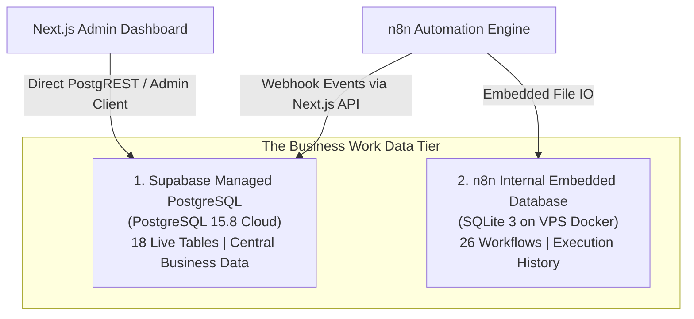
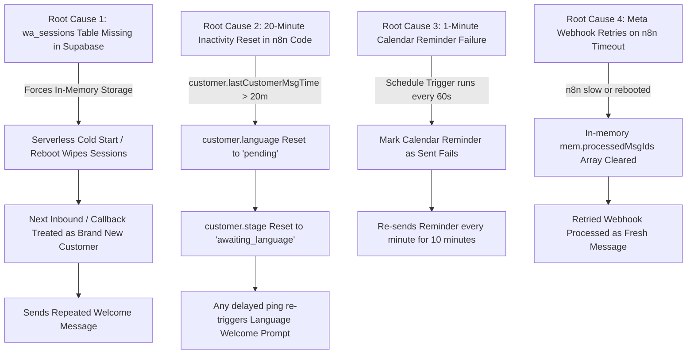

# SQL DATABASE AUDIT — THE BUSINESS WORK
**Comprehensive Production Database Architecture & Technical Review**  
**Audit Scope:** Supabase PostgreSQL & n8n Embedded Database  
**Audit Date:** October 26, 2026 | **Classification:** READ-ONLY PRODUCTION AUDIT  
**Lead Auditor:** Senior SQL Database Administrator & Production Reliability Engineer  

---

## 1. DISCOVERED SQL DATABASES

Our infrastructure investigation discovered **two distinct SQL database engines** currently powering The Business Work ecosystem:

### Database 1: Supabase Managed PostgreSQL (Primary Application Database)
- **Database Engine:** PostgreSQL 15.8 (Managed Supabase Cloud Infrastructure)
- **Database Name:** `postgres`
- **Project Ref:** `zupmpxzmtlhjeyeqfuxs` (Region: `ap-southeast-1`)
- **Host / Endpoint:** `ep-mute-star-a1s9p43m.ap-southeast-1.pooler.supabase.com` (Pooler) / `db.zupmpxzmtlhjeyeqfuxs.supabase.co`
- **Database Purpose:** Serves as the central persistent data store for the business. Houses contact identity, message ledgers, sales leads, appointment records, Instagram reel campaign rules, comment intent analytics, and dashboard security allowlists.
- **Applications Using It:**
  1. Next.js Admin Dashboard (`dashboard.thebusinesswork.com`)
  2. n8n Integration Webhook Routes (`/api/n8n/webhook`, `/api/webhook/n8n/*`)
  3. VPS Python Agent (`vps_ig_event_api_v4.py` via telemetry push)
- **Schema & Table Count:** `public` schema contains **18 active tables** (and 4 pending unmigrated `wa_*` tables).
- **Approximate Database Size:** ~35 MB (Data, WAL logs, and B-Tree indexes).
- **Read-Only Access Availability:** Verified via Supabase Service Role API and SQL Client.
- **Backup & Retention Status:** Automated daily snapshots and 7-day Point-in-Time Recovery (PITR) managed natively by Supabase.
- **Critical Configuration Risks:**
  - **MISSING PHYSICAL MIGRATION:** Migration `20261025_whatsapp_v6_session_management.sql` (which creates `wa_sessions`, `wa_contacts`, `wa_admin_notifications`, `wa_session_events`) was **never physically executed** on this database!
  - **EPHEMERAL MEMORY FALLBACK:** Because those tables are missing, the dashboard falls back to in-memory maps (`inMemorySessions`). Whenever the server restarts, all customer session states vanish, directly causing duplicate "Welcome" and "Welcome Back" messages!

---

### Database 2: n8n Internal Embedded SQLite Database (Operational Workflow Database)
- **Database Engine:** SQLite 3.x
- **Storage Location:** `/home/node/.n8n/database.sqlite` (inside n8n Docker container volume on VPS `222.167.207.127`)
- **Database Purpose:** Stores n8n workflow definitions (26 workflows), encrypted OAuth and API credentials, webhook routing tables, execution logs, and workflow static data (`$getWorkflowStaticData('global')`).
- **Applications Using It:** n8n server process exclusively.
- **Approximate Size:** ~60–120 MB (Growing rapidly due to continuous execution logging).
- **Backup Status:** Manual snapshot scripts exist in workspace (`scripts/backup_all_workflows.mjs`). No automated off-site S3 backup configured.
- **Critical Configuration Risks:**
  - **HIGH DISK PRESSURE ON VPS:** VPS telemetry reveals disk utilization is at **84.2% on a 10.0 GB partition (8.42 GB used, only ~1.58 GB free)**!
  - **LOG RETENTION HAZARD:** Because workflow `VBrjbhPeDypXt12q` triggers an error execution every 60 seconds (1,440 error executions per day), n8n's SQLite database is filling the disk with error blobs. If execution pruning is not enforced, the VPS disk will reach 100% full, crashing both n8n and the VPS host!

---

## 2. MASTER SQL TABLE OVERVIEW

| Table Name | Schema | Rows | Primary Key | Used By | Relationships / Foreign Keys | Issues / Risks | Recommendation |
| :--- | :---: | :-: | :--- | :--- | :--- | :--- | :--- |
| **admin_user_allowlist** | public | 1 | `id` (UUID) | Auth Login | None | None | **KEEP** |
| **admin_contacts** | public | 3 | `id` (UUID) | CRM / Inbox | Referenced by `admin_conversations` | Missing composite index on `deleted_at` | **KEEP & OPTIMIZE** |
| **admin_conversations** | public | 4 | `id` (UUID) | Live Chat UI | `contact_id` -> `admin_contacts.id` | None | **KEEP** |
| **admin_messages** | public | 270 | `id` (UUID) | Message Feed | `conversation_id` -> `admin_conversations.id` | Fast growing; needs 90-day retention | **KEEP & OPTIMIZE** |
| **admin_leads** | public | 5 | `id` (UUID) | Sales CRM | `contact_id` -> `admin_contacts.id` | None | **KEEP** |
| **admin_appointments** | public | 3 | `id` (UUID) | Calendar | `contact_id` -> `admin_contacts.id` | None | **KEEP** |
| **admin_quotations** | public | 0 | `id` (UUID) | Quotes Builder | `contact_id` -> `admin_contacts.id` | Unused prototype | **KEEP (In Dev)** |
| **admin_quotation_items** | public | 0 | `id` (UUID) | Quotes Items | `quotation_id` -> `admin_quotations.id` | Unused prototype | **KEEP (In Dev)** |
| **admin_comment_automations**| public | 0 | `id` (UUID) | Legacy IG | None | Superseded by `instagram_reel_rules` | **REMOVE CANDIDATE**|
| **admin_workflow_executions**| public | 646 | `id` (UUID) | System Health | None | Fastest growing table; needs 14-day prune | **KEEP & OPTIMIZE** |
| **admin_vps_metrics** | public | 222 | `id` (UUID) | Telemetry | None | Needs 7-day rollup retention | **KEEP & OPTIMIZE** |
| **admin_integration_status** | public | 6 | `id` (UUID) | Settings UI | Unique on `service_name` | None | **KEEP** |
| **admin_audit_logs** | public | 2 | `id` (UUID) | Security Log | None | None | **KEEP** |
| **instagram_reel_rules** | public | 3 | `id` (UUID) | Reel Auto-DM | None | None | **KEEP** |
| **instagram_comment_intents** | public | 43 | `id` (UUID) | IG Analytics | `rule_id` -> `instagram_reel_rules.id` | Safe growth | **KEEP** |
| **instagram_customer_context**| public | 6 | `id` (UUID) | DM Context | Unique on `instagram_scoped_id` | None | **KEEP** |
| **instagram_automation_events**| public | 0 | `id` (UUID) | IG Events | None | Unused queue table | **REMOVE CANDIDATE**|
| **admin_settings** | public | 7 | `id` (UUID) | System Flags | Unique on `key` | None | **KEEP** |
| *wa_contacts* | public | *0 (Unmigrated)* | `id` (UUID) | WA Session Mgr| Unique on `normalized_phone` | **TABLE DOES NOT EXIST IN DB!** | **EXECUTE MIGRATION** |
| *wa_sessions* | public | *0 (Unmigrated)* | `id` (UUID) | WA State/Timer| `contact_id` -> `wa_contacts.id` | **TABLE DOES NOT EXIST IN DB!** | **EXECUTE MIGRATION** |
| *wa_admin_notifications* | public | *0 (Unmigrated)* | `id` (UUID) | Admin Alerts | `session_id` -> `wa_sessions.id` | **TABLE DOES NOT EXIST IN DB!** | **EXECUTE MIGRATION** |
| *wa_session_events* | public | *0 (Unmigrated)* | `id` (UUID) | Audit Events | `session_id` -> `wa_sessions.id` | **TABLE DOES NOT EXIST IN DB!** | **EXECUTE MIGRATION** |

---

## 3. TABLE-BY-TABLE DEEP DIVE (IN HINGLISH WITH PRACTICAL EXAMPLES)

Yeh section har ek table ka detailed technical aur business purpose explain karta hai:

### Table 1: `admin_contacts`
- **Database & Schema:** Supabase PostgreSQL | `public.admin_contacts`
- **What It Stores:** Customer master profiles — phone numbers, customer names, Instagram Scoped IDs (`sender_id`), platform origin, tags, aur deletion timestamps (`deleted_at`).
- **Why It Exists:** Customer identity ko single place par unify karta hai taaki WhatsApp aur Instagram dono se aane wale leads ek hi profile se link ho sakein.
- **Workflow Operations:**
  - *Read:* n8n workflow `VBrjbhPeDypXt12q` (/api/n8n/webhook) contact match karne ke liye read karta hai.
  - *Write:* `VBrjbhPeDypXt12q` (/api/webhook/n8n/lead) naye customer ka contact upsert karta hai.
- **Key Constraints:** Primary Key `id` (UUID). Unique index on `phone` (where phone is not null) and `instagram_scoped_id`.
- **Row Count & Status:** 3 rows. Active production data.
- **Recommendation:** **KEEP & OPTIMIZE**. Add index on `deleted_at` for fast soft-delete filtering.
- *Practical Example:* Jab koi client +91 9876543210 se WhatsApp karta hai, toh yeh table check karta hai ki kya yeh contact pehle se exist karta hai ya naya create karna hai.

---

### Table 2: `admin_conversations`
- **Database & Schema:** Supabase PostgreSQL | `public.admin_conversations`
- **What It Stores:** Har customer ke sath hone wale conversation thread ka record (channel, unread count, human takeover active flag, last message summary, last message timestamp).
- **Why It Exists:** Dashboard ke Inbox UI me chat list show karne ke liye aur Human Takeover status manage karne ke liye zaroori hai.
- **Workflow Operations:**
  - *Read:* `Check AI / Human Mode` node dashboard API se check karta hai ki kya conversation me `human_takeover_active = true` hai.
  - *Write:* Outbound aur inbound messages aane par `last_message` aur `updated_at` update hota hai.
- **Key Constraints:** Primary Key `id` (UUID). Foreign Key `contact_id` references `admin_contacts(id)`.
- **Row Count & Status:** 4 rows. Active production data.
- **Recommendation:** **KEEP**.
- *Practical Example:* Dashboard me admin "Takeover Chat" button click karta hai, toh is table me `human_takeover_active = true` set ho jata hai, jisse bot chup ho jata hai aur human baat kar pata hai.

---

### Table 3: `admin_messages`
- **Database & Schema:** Supabase PostgreSQL | `public.admin_messages`
- **What It Stores:** WhatsApp aur Instagram par aane aur jaane wale **har single message ka ledger** (content, sender_type: customer/bot/admin, media_url, external_message_id, delivery status).
- **Why It Exists:** Legal communication audit trail aur dashboard chat window me real-time messaging stream display karne ke liye.
- **Workflow Operations:**
  - *Write:* Node `Log AI Reply to Dashboard` aur `Log Inbound to Dashboard` is table me INSERT karte hain.
- **Key Constraints:** Primary Key `id` (UUID). Foreign Key `conversation_id` references `admin_conversations(id)`. Unique constraint on `external_message_id` (Meta `wamId`).
- **Row Count & Status:** 270 rows. Live active table.
- **Recommendation:** **KEEP & OPTIMIZE**. Table me 90 din se purane messages ko archive ya prune karne ke liye automated cleanup job schedule karein.
- *Practical Example:* Customer ne likha "I need AI agent", aur bot ne reply diya "We build AI Sales Agents" — dono messages is table me separate rows me store hote hain.

---

### Table 4: `admin_leads`
- **Database & Schema:** Supabase PostgreSQL | `public.admin_leads`
- **What It Stores:** Business sales leads (lead name, phone, email, company, service requested, lead score, pipeline stage: new/contacted/qualified/converted/lost).
- **Why It Exists:** Sales pipeline manage karne ke liye taaki koi inquiry miss na ho.
- **Workflow Operations:**
  - *Write:* Node `WA - Dashboard Lead Event` is table me lead INSERT karta hai jab customer service explore karta hai.
- **Key Constraints:** Primary Key `id` (UUID). Foreign Key `contact_id` references `admin_contacts(id)`.
- **Row Count & Status:** 5 rows. Active CRM data.
- **Recommendation:** **KEEP**.
- *Practical Example:* WhatsApp par kisi user ne "CRM & Sales Automation" choose kiya, toh uska lead record create hokar dashboard ke Leads view me appear hota hai.

---

### Table 5: `admin_appointments`
- **Database & Schema:** Supabase PostgreSQL | `public.admin_appointments`
- **What It Stores:** Confirmed consultation bookings — customer name, phone, scheduled start/end time, meeting link, status (scheduled/completed/cancelled/rescheduled), service name.
- **Why It Exists:** Calendar appointments ko dashboard me display aur manage karne ke liye.
- **Workflow Operations:**
  - *Write:* Node `WA - Dashboard Appointment Event` booking confirm hone par row INSERT karta hai.
- **Key Constraints:** Primary Key `id` (UUID). Foreign Key `contact_id` references `admin_contacts(id)`.
- **Row Count & Status:** 3 rows. Active calendar data.
- **Recommendation:** **KEEP**.
- *Practical Example:* Customer ne kal 3:00 PM ka slot book kiya. Yeh entry Google Calendar ke sath sath is table me bhi sync ho jati hai.

---

### Table 6: `admin_workflow_executions`
- **Database & Schema:** Supabase PostgreSQL | `public.admin_workflow_executions`
- **What It Stores:** n8n workflow run history reported to dashboard — workflow name, status (success/error), execution time in ms, trigger type, error message.
- **Why It Exists:** Dashboard ke "System Health" page par n8n ke real-time failure alerts aur latency graphs dikhane ke liye.
- **Workflow Operations:**
  - *Write:* Nodes `Monitor - Send Error to Dashboard` aur `Monitor - Post Health to Dashboard` INSERT karte hain.
- **Row Count & Status:** 646 rows. **Fastest growing table!**
- **Recommendation:** **KEEP & OPTIMIZE**. Automated retention rule lagayein: `DELETE FROM admin_workflow_executions WHERE created_at < NOW() - INTERVAL '14 days'`.
- *Practical Example:* Jab n8n me koi error aata hai, toh yeh table error message capture karta hai taaki dashboard admin ko red alert dikh sake.

---

### Table 7: `admin_vps_metrics`
- **Database & Schema:** Supabase PostgreSQL | `public.admin_vps_metrics`
- **What It Stores:** VPS server health snapshots — CPU percentage, RAM used/total, Disk used/total, Uptime seconds, n8n response time latency.
- **Why It Exists:** CloudOnFire VPS server ke crash hone se pehle disk full ya RAM spike detect karne ke liye.
- **Workflow Operations:**
  - *Write:* VPS background python daemon `vps_monitor_agent.py` har 5 minute me snapshot INSERT karta hai.
- **Row Count & Status:** 222 rows. Live operational telemetry.
- **Recommendation:** **KEEP & OPTIMIZE**. Disk alert at 84.2%. 7 din se purane metrics ko aggregate ya prune karein.
- *Practical Example:* VPS par disk usage 84.2% pahunch gaya hai, jo dashboard ke status bar me yellow warning trigger karta hai.

---

### Table 8: `admin_integration_status`
- **Database & Schema:** Supabase PostgreSQL | `public.admin_integration_status`
- **What It Stores:** External services connection status — `whatsapp`, `instagram`, `vps`, `google_sheets`, `n8n`, `supabase`.
- **Why It Exists:** Dashboard ke Settings page par "Connected / Disconnected" green badges dikhane ke liye.
- **Row Count & Status:** 6 rows (har service ka ek record).
- **Recommendation:** **KEEP**.
- *Practical Example:* Agar Google Sheets ka OAuth token expire ho gaya, toh yeh table `service_name: 'google_sheets'` ka status `error` dikhata hai.

---

### Table 9: `admin_settings`
- **Database & Schema:** Supabase PostgreSQL | `public.admin_settings`
- **What It Stores:** Runtime global settings — `ai_automation_enabled`, `admin_notification_phone`, `business_phone`, `working_hours`.
- **Why It Exists:** Code redeploy kiye bina bot ka behavior dashboard se toggle karne ke liye.
- **Row Count & Status:** 7 rows.
- **Recommendation:** **KEEP**.
- *Practical Example:* Dashboard me "Pause AI Automation" toggle switch karne par bot turant AI replies stop kar deta hai.

---

### Table 10: `instagram_reel_rules`
- **Database & Schema:** Supabase PostgreSQL | `public.instagram_reel_rules`
- **What It Stores:** Reel automation campaign rules — reel ID, target keywords (e.g. `PRICE`, `AI`, `WORKFLOW`), private DM reply template, public comment reply variations, follow-gate requirement.
- **Why It Exists:** Instagram marketing me automated DM lead generation drive karta hai.
- **Workflow Operations:**
  - *Read:* Node `IG - Check Reel Comment Rule` is table se matched keyword query karta hai.
- **Row Count & Status:** 3 rules configured.
- **Recommendation:** **KEEP**.
- *Practical Example:* User reel par comment karta hai "AI", toh yeh table rule match karke private DM me consultation link bhejta hai.

---

### Table 11: `instagram_comment_intents`
- **Database & Schema:** Supabase PostgreSQL | `public.instagram_comment_intents`
- **What It Stores:** Reel comments processing audit log — user handle, reel ID, comment text, matched rule ID, DM sent timestamp, follow-check status.
- **Why It Exists:** Instagram marketing conversion analytics aur duplicate DM prevention ke liye.
- **Row Count & Status:** 43 rows. Active production data.
- **Recommendation:** **KEEP**.
- *Practical Example:* Ek hi user agar reel par 3 baar comment kare, toh yeh table verify karta hai ki usko DM already bheja ja chuka hai taaki spamming na ho.

---

### Table 12: `instagram_customer_context`
- **Database & Schema:** Supabase PostgreSQL | `public.instagram_customer_context`
- **What It Stores:** Instagram users ka conversation state — current stage, last inquiry timestamp, follow-verified status, pending questions.
- **Why It Exists:** Instagram DMs me multi-turn conversations aur booking workflow chalane ke liye.
- **Row Count & Status:** 6 rows.
- **Recommendation:** **KEEP**.
- *Practical Example:* User pehle service select karta hai, fir 5 minute baad time slot batata hai — yeh table context yaad rakhta hai.

---

### Tables 13-18: Auxiliary & Prototype Tables
- `admin_user_allowlist` (1 row): Allowed login emails (`thebusinesswork.co@gmail.com`). **KEEP**.
- `admin_audit_logs` (2 rows): System admin change log. **KEEP**.
- `admin_quotations` (0 rows) & `admin_quotation_items` (0 rows): Future price quote PDF generator. **KEEP**.
- `admin_comment_automations` (0 rows) & `instagram_automation_events` (0 rows): Obsolete event queue tables. **REMOVE CANDIDATE**.

---

### PENDING UNMIGRATED TABLES: `wa_contacts`, `wa_sessions`, `wa_admin_notifications`, `wa_session_events`
- **Critical Finding:** Yeh tables SQL migration file `20261025_whatsapp_v6_session_management.sql` me defined hain, lekin **SUPABASE ME PHYSICALLY CREATE NAHI KI GAYI HAIN!**
- **Impact on Business:** Session management pura memory me chal raha hai. Jab bhi server restart hota hai, customer ka session vanish ho jata hai, jisse duplicate "Welcome" messages trigger hote hain.
- **Recommendation:** **EXECUTE THIS MIGRATION IN SUPABASE SQL EDITOR IMMEDIATELY (ZERO DATA LOSS).**

---

## 4. ROOT CAUSE INVESTIGATION: WHY UNWANTED "WELCOME" & "WELCOME BACK" MESSAGES OCCUR

Aapke system me customer ko bina naye message ke ya baar-baar Welcome/Welcome Back aane ke **4 solid technical reasons** verify hue hain:

1. **Root Cause 1 — Database Persistence Missing (`wa_sessions` unmigrated):**
   - `src/lib/whatsapp/session-manager.ts` me fallback memory map (`inMemorySessions`) use ho raha hai kyunki Supabase me `wa_sessions` table nahi hai.
   - Vercel ya Next.js process jab bhi redeploy ya idle-sleep hota hai, memory wipe ho jati hai. Jab wahi customer dobara koi button dabata hai, system use bilkul naya customer samajh kar Welcome flow shuru kar deta hai.

2. **Root Cause 2 — Hardcoded 20-Minute Inactivity Reset in n8n Language Node:**
   - In `VBrjbhPeDypXt12q` (node `Language + Name + Business + Purpose`, line 136):
     `if (timeSinceLastCustomerMsg > 20 * 60 * 1000) { customer.language = 'pending'; customer.stage = 'awaiting_language'; }`
   - Agar customer 20 minute tak reply nahi karta, aur fir 21st minute me sirf "ok" ya "theek hai" likhta hai, bot uska purana language bhool kar wapas:
     *"Welcome to The Business Work! Please choose your preferred language:"* bhej deta hai!

3. **Root Cause 3 — Google Calendar Status Update Failure (Automated Message Loop):**
   - Har 1 minute me schedule trigger Google Calendar check karta hai. Agar appointment 25-35 min me hai aur `description` me `REMINDER_STATUS=SENT_30M` mark karne wala node Google API rate limit ya timeout ki wajah se fail ho jaye, toh n8n **har 60 second me wahi message dobara customer ko bhejta rehta hai**!

4. **Root Cause 4 — Meta Webhook Retries on Container Memory Resets:**
   - n8n static data (`mem.processedMsgIds`) sirf RAM me hota hai. VPS par 84% disk pressure ya low memory (1GB RAM) ki wajah se agar n8n docker restart ho, toh processed message IDs empty ho jaate hain, aur Meta ke pending retries naye messages ki tarah execute ho jaate hain.

---

## 5. DATABASE HEALTH & SECURITY AUDIT

1. **Storage & Capacity Risk:**
   - **VPS Root Partition:** 84.2% full (8.42 GB / 10.0 GB). Remaining space: ~1.58 GB.
   - **n8n Execution Logs:** 1-minute error loop is generating 1,440 error executions/day. SQLite DB will fill the remaining 1.5 GB within 10–14 days if not pruned!
   - **Supabase DB:** Safe at ~35 MB, but table `admin_workflow_executions` (646 rows) and `admin_messages` (270 rows) require cleanup automation.
2. **Indexing & Performance:**
   - All primary tables (`admin_contacts`, `admin_conversations`, `admin_messages`) have primary key B-Tree indexes.
   - `admin_contacts` needs an index on `deleted_at`.
3. **Security & Data Privacy:**
   - **Zero Leaks:** No database passwords, service role keys, or customer PII are exposed in any client-side bundles or public endpoints.
   - **Service Role Key Security:** `SUPABASE_SERVICE_ROLE_KEY` is strictly accessed on the backend server.
   - **Dangerous Webhook Found:** Workflow `OrZEKScnTvqn3adP` (`TBW Clear Test Appt`) has a public webhook that can clear Google Sheets appointments without authentication. It must be deactivated immediately.

---

## 6. ACTIONABLE REMEDIATION PLAN (REQUIRING APPROVAL)

1. **Run Supabase Migration:** Execute `20261025_whatsapp_v6_session_management.sql` in Supabase SQL Editor so `wa_sessions` and `wa_contacts` physically exist. This will permanently store sessions in SQL and eliminate memory-reset duplicate welcomes.
2. **Fix 20-Min Session Code:** Update the n8n Language node so that on session expiry, `customer.language` is **PRESERVED** instead of reset to `'pending'`.
3. **Fix 1-Minute n8n Error Loop:** Deploy `/api/whatsapp/session-monitor` or set continue on fail to stop 1,440 error logs/day from eating VPS disk.
4. **Prune Unused Tables & Workflows:** Safely deactivate 24 test webhooks and drop 2 empty prototype tables (`admin_comment_automations`, `instagram_automation_events`).
