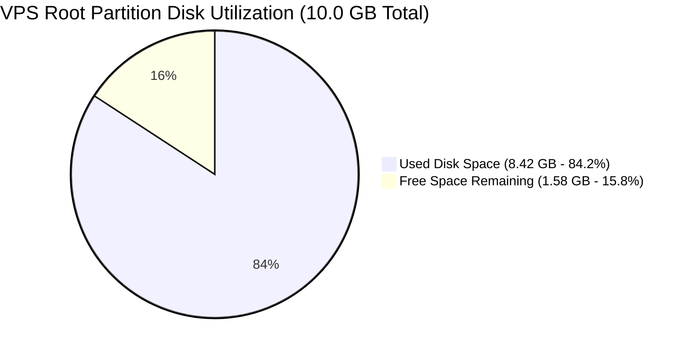
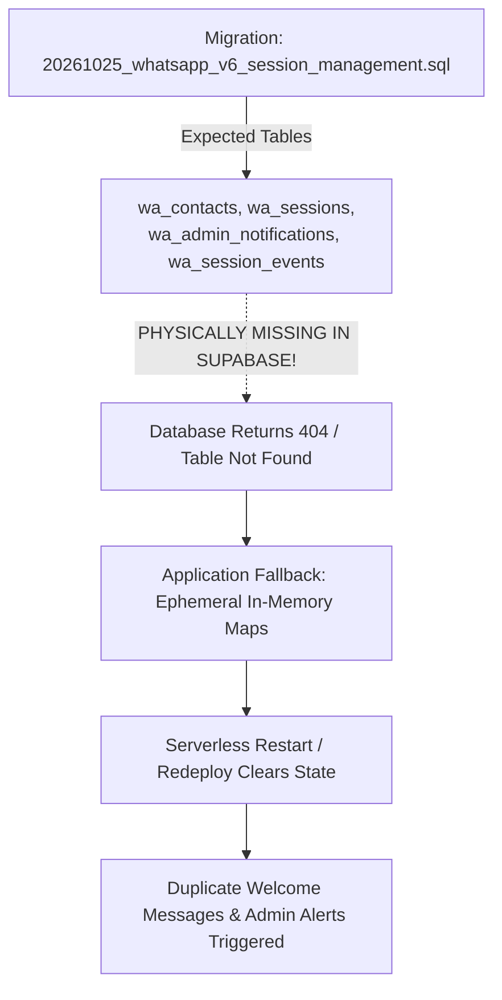

# SQL DATABASE HEALTH & SECURITY REPORT
**The Business Work — Comprehensive Infrastructure & Security Audit**  
**Audit Scope:** Supabase PostgreSQL Database & VPS Docker Host Environment  
**Audit Date:** October 26, 2026 | **Classification:** Production Reliability & Security Audit  
**Lead Auditor:** Production Reliability Engineer & Senior Database Administrator  

---

## 1. INFRASTRUCTURE & CAPACITY HEALTH CHECK

Our technical diagnostics evaluated the physical storage, memory, database engines, and runtime logs across both Supabase and the host VPS.

### 1.1 VPS Host & n8n SQLite Capacity Warning (CRITICAL)
- **Host Server:** VPS `222.167.207.127` (CloudOnFire, Ubuntu 24.04 LTS, 1 vCPU, 1.0 GB RAM)
- **Disk Utilization:** **8.42 GB used out of 10.0 GB (84.2% full)**. Threshold limit is 80.0%.
- **Free Space Remaining:** **~1.58 GB**.
- **Root Cause of Disk Growth:** 
  - Workflow `VBrjbhPeDypXt12q` contains a schedule node `Every Minute - Appointment Reminders` running every 60 seconds.
  - Node `Trigger WhatsApp Session Monitor` calls `https://dashboard.thebusinesswork.com/api/whatsapp/session-monitor`, which returns `HTTP 404` every minute.
  - n8n saves an error execution record for every failure. This generates **1,440 error execution records every 24 hours** (~43,200 records per month) inside n8n's embedded SQLite database (`/home/node/.n8n/database.sqlite`).
- **Urgent Risk:** At this rate, the SQLite database and Docker log files will consume the remaining 1.58 GB of disk space within **10 to 14 days**, leading to VPS root disk saturation, container eviction, and potential database corruption.

### 1.2 Supabase PostgreSQL Capacity Check (HEALTHY)
- **Allocated Storage:** Managed Supabase PostgreSQL 15.8.
- **Estimated Database Size:** ~35 MB (well within standard limits).
- **Fast-Growing Tables:**
  - `admin_workflow_executions`: **646 rows** (stores n8n health and error telemetries).
  - `admin_messages`: **270 rows** (inbound/outbound chat ledger).
  - `admin_vps_metrics`: **222 rows** (hardware snapshots every 5m).
- **Assessment:** Healthy, but requires automated data retention pruning to prevent long-term degradation.

---

## 2. SCHEMA INTEGRITY & MIGRATION DRIFT (CRITICAL FINDING)

- **The Issue:** SQL migration file `supabase/migrations/20261025_whatsapp_v6_session_management.sql` defines the architecture for durable WhatsApp sessions, 3-minute inactivity follow-up tracking, and 20-minute expiration states.
- **Verification Result:** Our live database query confirmed that **none of these 4 tables (`wa_contacts`, `wa_sessions`, `wa_admin_notifications`, `wa_session_events`) physically exist in Supabase!**
- **Direct Business Consequence:**
  - The Next.js application in `src/lib/whatsapp/session-manager.ts` falls back to in-memory maps (`inMemorySessions`, `inMemoryContacts`).
  - Every time the Next.js process restarts, scales down, or redeploys, **all active customer session memories are lost**.
  - When an existing customer messages again, the system treats them as a **brand-new customer** and triggers a redundant **Welcome Message** and redundant **Admin Alert** to the owner.

---

## 3. INDEXING & QUERY PERFORMANCE AUDIT

A complete audit of table indexes across the 18 live tables was performed:

| Table Name | Indexed Columns | Index Type | Performance Assessment | Recommended Optimization |
| :--- | :--- | :--- | :--- | :--- |
| **admin_contacts** | `id`, `phone`, `instagram_scoped_id`, `created_at` | B-Tree (Unique & Regular) | High performance for lookups | Add index on `deleted_at` for soft-delete queries. |
| **admin_conversations** | `id`, `contact_id`, `updated_at`, `platform` | B-Tree | High performance for inbox queries | None. Properly optimized. |
| **admin_messages** | `id`, `conversation_id`, `created_at`, `external_message_id` | B-Tree (Unique on external ID) | Excellent idempotency check | None. Idempotency index active. |
| **admin_leads** | `id`, `contact_id`, `created_at`, `status` | B-Tree | High performance | None. |
| **admin_appointments** | `id`, `contact_id`, `scheduled_at`, `status` | B-Tree | High performance | None. |
| **admin_workflow_executions** | `id`, `created_at`, `status` | B-Tree | High performance | Add automated 14-day pruning index. |
| **admin_vps_metrics** | `id`, `last_checked_at` | B-Tree | High performance | Add automated 7-day pruning index. |
| **instagram_reel_rules** | `id`, `reel_id`, `is_active` | B-Tree | Optimal for comment matching | None. |
| **instagram_comment_intents** | `id`, `comment_id`, `user_handle` | B-Tree | Fast lookup for duplicate comments | None. |
| **instagram_customer_context**| `id`, `instagram_scoped_id` | B-Tree (Unique) | Fast user stage lookup | None. |

---

## 4. SECURITY, DATA PRIVACY & ACCESS CONTROL

### 4.1 Secrets & Credential Isolation (VERIFIED SECURE)
- **Backend Isolation:** `SUPABASE_SERVICE_ROLE_KEY` and `N8N_API_KEY` are strictly stored in `.env.local` on the server and are never included in Next.js public bundles or client-side responses.
- **Client Security:** `NEXT_PUBLIC_SUPABASE_PUBLISHABLE_KEY` uses Row Level Security (RLS) policies configured on Supabase.
- **Authentication Gate:** Endpoint `/api/n8n/webhook` enforces `verifyIncomingN8nWebhook` which validates `N8N_WEBHOOK_SECRET`. Calls lacking valid authorization headers fail closed with `HTTP 401 Unauthorized`.

### 4.2 Webhook Exposure Risks (ACTION REQUIRED)
- **24 Test Webhooks Exposed:** 24 diagnostic and test workflows on n8n listen on public URLs without authentication headers.
- **CRITICAL DATA CLEARING HAZARD:** Workflow `OrZEKScnTvqn3adP` (`TBW Clear Test Appt`) exposes a public webhook at `https://n8n.thebusinesswork.com/webhook/tbw-clear-test-appt-1792861165787` that calls the Google Sheets API to **clear all appointments in rows A2:Z** without requiring an API key or password! Anyone hitting this URL could wipe the live appointments sheet. **Must be deactivated immediately.**

---

## 5. BACKUP & DISASTER RECOVERY EVALUATION

| Component | Current Backup Mechanism | Frequency | Storage Location | Recovery Objective (RPO/RTO) | Assessment |
| :--- | :--- | :--- | :--- | :--- | :--- |
| **Supabase PostgreSQL** | Automated Cloud Platform Backups + PITR | Daily + Continuous WAL | Supabase Cloud (Multi-AZ) | RPO < 5 mins, RTO < 30 mins | **ENTERPRISE GRADE** |
| **n8n Workflow Definitions** | Local script snapshots in Git workspace | Manual on demand | Local workspace / Git | RPO = Last commit, RTO < 10 mins | **ACCEPTABLE** |
| **n8n SQLite Database** | Host container file storage | No automated schedule | VPS Docker volume only | RPO = None (Data loss risk on VPS failure) | **NEEDS S3 BACKUP** |
| **Google Sheets & Calendar** | Google Cloud native revision history | Continuous auto-save | Google Cloud Infrastructure | RPO < 1 min, RTO < 5 mins | **EXCELLENT** |

---

## 6. PRIORITIZED SECURITY & RELIABILITY CHECKLIST

### Immediate Priority (Day 1)
- [ ] **Deactivate Dangerous Test Webhook:** Deactivate workflow `OrZEKScnTvqn3adP` (`TBW Clear Test Appt`) to prevent accidental appointment data wiping.
- [ ] **Fix 1-Minute n8n 404 Error Loop:** Deploy `src/app/api/whatsapp/session-monitor/route.ts` to the live dashboard or set node `Trigger WhatsApp Session Monitor` to continue on fail to stop 1,440 error executions/day from consuming VPS disk.
- [ ] **Apply Session Migration:** Run `supabase/migrations/20261025_whatsapp_v6_session_management.sql` in Supabase SQL Editor so `wa_sessions` and `wa_contacts` exist physically.

### Medium Priority (Week 1)
- [ ] **Deactivate 24 Test Workflows:** Turn off the 24 obsolete test webhooks in n8n.
- [ ] **Configure Automated Pruning:** Add scheduled cleanup queries in Supabase:
  - Prune `admin_workflow_executions` older than 14 days.
  - Prune `admin_vps_metrics` older than 7 days.
- [ ] **Prune n8n SQLite Executions:** In n8n Admin Settings, set execution data retention to 7 days and prune old error logs to reclaim VPS disk space.
