# SQL + N8N WORKFLOW DEPENDENCY MAP
**The Business Work — End-to-End System Integration Architecture**  
**Audit Date:** October 26, 2026 | **Classification:** Technical Architecture Specification  
**Lead Architect:** Senior n8n Automation Architect & Database Administrator  

---

## 1. END-TO-END DATA FLOW ARCHITECTURE

This document establishes the verified runtime dependencies connecting customer entrypoints, n8n workflows, Next.js dashboard API endpoints, Supabase PostgreSQL database tables, and external SaaS services.

```mermaid
flowchart TD
    subgraph "External Channels"
        CustWA["Customer WhatsApp<br/>(+91 7972020292)"]
        CustIG["Customer Instagram<br/>(@thebusinesswork)"]
        OwnerWA["Admin Personal WhatsApp<br/>(+91 8604600292)"]
        GCal["Google Calendar<br/>(TBW Primary)"]
        GSheets["Google Sheets<br/>(Master Leads & Bookings)"]
    end

    subgraph "n8n Automation Engine"
        WF_V4["VBrjbhPeDypXt12q<br/>TBW V4 PRO Production Monolith"]
        WF_Sync["odtJnhwngB1l8Ku2<br/>Master Sync Engine"]
    end

    subgraph "Next.js Dashboard API Tier"
        API_N8N["/api/n8n/webhook"]
        API_Lead["/api/webhook/n8n/lead"]
        API_Appt["/api/webhook/n8n/appointment"]
        API_Event["/api/webhook/n8n/event"]
        API_Health["/api/webhook/n8n/health"]
        API_Error["/api/webhook/n8n/error"]
        API_IG_Check["/api/instagram/comment-check"]
        API_IG_Ctx["/api/instagram/dm-context"]
        API_SessMon["/api/whatsapp/session-monitor<br/>(Local / Unmigrated - 404)"]
    end

    subgraph "Supabase PostgreSQL Database"
        T_Contacts[("public.admin_contacts")]
        T_Convs[("public.admin_conversations")]
        T_Msgs[("public.admin_messages")]
        T_Leads[("public.admin_leads")]
        T_Appts[("public.admin_appointments")]
        T_Rules[("public.instagram_reel_rules")]
        T_Intents[("public.instagram_comment_intents")]
        T_Context[("public.instagram_customer_context")]
        T_Execs[("public.admin_workflow_executions")]
        T_Status[("public.admin_integration_status")]
        T_Settings[("public.admin_settings")]
    end

    CustWA -->|Inbound Message| WF_V4
    CustIG -->|Reel Comment / DM| WF_V4
    WF_V4 -->|Admin Alert| OwnerWA
    WF_V4 -->|Create / Reschedule| GCal
    WF_V4 -->|Append Row| GSheets
    WF_V4 -->|Sync Data| API_N8N
    WF_V4 -->|Log Lead| API_Lead
    WF_V4 -->|Log Appointment| API_Appt
    WF_V4 -->|State Event| API_Event
    WF_V4 -->|Health Ping| API_Health
    WF_V4 -->|Error Catch| API_Error
    WF_V4 -->|Check Keyword| API_IG_Check
    WF_V4 -->|Resolve Context| API_IG_Ctx
    WF_V4 -.->|1-min 404 Loop| API_SessMon

    API_N8N -->|UPSERT / READ| T_Contacts
    API_N8N -->|UPDATE / READ| T_Convs
    API_N8N -->|INSERT| T_Msgs
    API_N8N -->|READ| T_Settings
    API_Lead -->|INSERT / UPDATE| T_Leads
    API_Lead -->|UPSERT| T_Contacts
    API_Appt -->|INSERT / UPDATE| T_Appts
    API_IG_Check -->|SELECT| T_Rules
    API_IG_Check -->|INSERT| T_Intents
    API_IG_Ctx -->|SELECT / UPSERT| T_Context
    API_Health -->|INSERT| T_Execs
    API_Health -->|UPSERT| T_Status
    API_Error -->|INSERT| T_Execs

    WF_Sync -->|Batch Sync| GSheets
    WF_Sync -->|Sync Events| GCal
    WF_Sync -.->|Sync Appts| T_Appts
```

---

## 2. DETAILED TRACE: WORKFLOW -> API -> TABLE -> OPERATION

### Trace 1: Inbound WhatsApp Customer Flow
- **Workflow:** `VBrjbhPeDypXt12q`
- **Trigger Node:** `Incoming WhatsApp Message` (`whatsAppTrigger`)
- **Step 1 (Inbound Log):** Node `Log Inbound to Dashboard` calls `POST https://dashboard.thebusinesswork.com/api/n8n/webhook` with `event_type: 'incoming_whatsapp_message'`.
  - **SQL Operation:** 
    - `admin_contacts`: UPSERT contact record (normalized phone, profile name).
    - `admin_conversations`: UPSERT active conversation thread (`platform: 'whatsapp'`, `last_message`, `last_message_at`).
    - `admin_messages`: INSERT incoming customer message with `sender_type: 'customer'`, `status: 'sent'`, `external_message_id: wamId`.
- **Step 2 (Admin Alert):** Node `Send Admin WhatsApp Alert` dispatches template to `+91 8604600292` via Meta Cloud API.
- **Step 3 (Bot Outbound Reply):** Node `Send WhatsApp Interactive` sends interactive buttons via Meta Cloud API.
- **Step 4 (Outbound Log):** Node `Log AI Reply to Dashboard` calls `POST https://dashboard.thebusinesswork.com/api/n8n/webhook` with `event_type: 'log_ai_reply'`.
  - **SQL Operation:**
    - `admin_messages`: INSERT outgoing bot reply with `sender_type: 'bot'`, `metadata: { interactive, buttons }`.
    - `admin_conversations`: UPDATE `last_message` and increment activity timestamp.

---

### Trace 2: Lead Capture Pipeline
- **Workflow:** `VBrjbhPeDypXt12q`
- **Node:** `WA - Dashboard Lead Event`
- **Endpoint:** `POST https://dashboard.thebusinesswork.com/api/webhook/n8n/lead`
- **Payload:** `{ name, phone, service, category, business, source: 'whatsapp' }`
- **SQL Operations:**
  1. `admin_contacts`: UPSERT customer contact with tags `['whatsapp', 'lead']`.
  2. `admin_leads`: INSERT new lead record with `status: 'new'`, `source: 'whatsapp'`, `service_requested: service`.
- **Google Sheets Parallel Write:** Node `Save WhatsApp Lead to Google Sheets` writes directly to spreadsheet tab `WhatsApp Leads` (`gid: 671996512`).

---

### Trace 3: Appointment Booking & Rescheduling Pipeline
- **Workflow:** `VBrjbhPeDypXt12q`
- **Nodes Involved:**
  - `Google Calendar - Busy Times for Date`: Queries primary calendar for busy periods.
  - `Google Calendar - Recheck Selected Slot`: Verifies slot availability immediately before locking.
  - `Google Calendar - Create Booking` / `Update Booking`: Writes event to Google Calendar with description tags (`TBW_APPOINTMENT`, `PHONE=...`, `CUSTOMER_NAME=...`, `REMINDER_STATUS=PENDING`).
  - `Save Booked Appointment to Google Sheets`: Appends appointment row to Google Sheet `Appointments` tab (`gid: 949713765`).
  - `WA - Dashboard Appointment Event`: Calls `POST https://dashboard.thebusinesswork.com/api/webhook/n8n/appointment`.
- **SQL Operations:**
  1. `admin_appointments`: INSERT or UPDATE appointment record (`scheduled_at`, `status: 'scheduled'`, `service_name`, `calendar_event_id`).

---

### Trace 4: 30-Minute Automated Reminder Engine
- **Workflow:** `VBrjbhPeDypXt12q`
- **Trigger Node:** `Every Minute - Appointment Reminders` (`scheduleTrigger`, interval: 1 minute)
- **Node 1:** `Google Calendar - Upcoming TBW Events` (Queries events where start time is between `now + 25m` and `now + 35m`).
- **Node 2:** `Prepare Due WhatsApp Template Reminders` (Filters out events already containing `REMINDER_STATUS=SENT_30M`).
- **Node 3:** `Send WhatsApp 30-Minute Reminder` (Dispatches WhatsApp message to customer via Meta Cloud API).
- **Node 4:** `Mark Calendar Reminder as Sent` (Updates Google Calendar event description to append `REMINDER_STATUS=SENT_30M`).
- **SQL Operation:** None directly; purely coordinates between Google Calendar and WhatsApp Meta Cloud API.

---

### Trace 5: Instagram Reel Comment Auto-DM Pipeline
- **Workflow:** `VBrjbhPeDypXt12q`
- **Trigger Node:** `IG - Verified Events In` (`webhook: tbw-v3-instagram-verified-events`)
- **Step 1 (Idempotency):** Node `IG - Register Event + Idempotency` calls VPS container `POST http://172.18.0.1:3002/register`.
- **Step 2 (Rule Check):** Node `IG - Check Reel Comment Rule` calls `POST https://dashboard.thebusinesswork.com/api/instagram/comment-check`.
  - **SQL Operation:**
    - `instagram_reel_rules`: SELECT rule matching `reel_id` and comment text keyword.
    - `instagram_comment_intents`: INSERT intent audit record (`user_handle`, `comment_text`, `matched_rule_id`, `dm_sent: true`).
- **Step 3 (Send Private DM):** Node `IG - Send via Meta Instagram API` sends DM via Meta Graph API.
- **Step 4 (Public Reply):** Node `IG - Post-Send Event & Public Reply` calls `POST https://dashboard.thebusinesswork.com/api/instagram/send-public-reply` to post an engaging public reply on the reel comment.

---

### Trace 6: Dashboard Outbox Dispatcher
- **Workflow:** `VBrjbhPeDypXt12q`
- **Trigger Node:** `Dashboard - Authenticated Outbox` (`webhook: tbw-v3-dashboard-outbox`)
- **Action:** When dashboard staff send a manual message, quote, or template from the Inbox, Next.js calls this n8n webhook.
- **Node:** `Dashboard - Send WhatsApp` sends the message via Meta Cloud API.
- **Node:** `Dashboard - Log WhatsApp Send` calls `/api/webhook/n8n/quotation/send-result`.
  - **SQL Operation:**
    - `admin_messages`: UPDATE message delivery status.
    - `admin_audit_logs`: INSERT audit record tracking staff member action.

---

### Trace 7: Master Sync Engine (Broken)
- **Workflow:** `odtJnhwngB1l8Ku2` (`TBW Master Google Sheets & Calendar Sync Engine`)
- **Trigger Node:** `Webhook Inbound` (`path: tbw-google-sheets-sync`)
- **Target Operations:** Intended to read `Leads`, `WhatsApp Leads`, and `Appointments` tabs from Google Sheets via batchGet, synchronize with Google Calendar, and update Supabase `admin_appointments`.
- **Current Status:** **FAILS AT NODE 3** (`Batch Get All Sheets`) because the Google Sheets OAuth2 credential expired.

---

## 3. MASTER SQL TABLE INTERACTION MATRIX

| SQL Table | Read By | Written By | Primary Purpose |
| :--- | :--- | :--- | :--- |
| **admin_contacts** | Dashboard UI, `/api/n8n/webhook` | `/api/n8n/webhook`, `/api/webhook/n8n/lead` | Master customer directory |
| **admin_conversations** | Dashboard Inbox, `/api/n8n/webhook` | `/api/n8n/webhook` | Channel thread state & takeover flag |
| **admin_messages** | Dashboard Inbox Chat Feed | `/api/n8n/webhook` | Complete message ledger |
| **admin_leads** | Dashboard Leads page | `/api/webhook/n8n/lead` | CRM prospect pipeline |
| **admin_appointments**| Dashboard Calendar page | `/api/webhook/n8n/appointment` | Consultation bookings |
| **admin_workflow_executions** | Dashboard System Health | `/api/webhook/n8n/error`, `/health` | n8n error & execution telemetry |
| **admin_vps_metrics** | Dashboard Status Bar | VPS Monitor Daemon (`/api/vps/health`) | Server hardware & disk monitoring |
| **admin_integration_status** | Dashboard Settings page | All webhook routes & VPS daemon | External service connectivity status |
| **admin_settings** | `/api/n8n/webhook`, Dashboard UI | Dashboard Settings UI | Automation toggles & business rules |
| **instagram_reel_rules** | `/api/instagram/comment-check` | Dashboard Reel Manager UI | Keyword auto-reply rules |
| **instagram_comment_intents** | Dashboard Analytics | `/api/instagram/comment-check` | Reel comment audit trail |
| **instagram_customer_context**| `/api/instagram/dm-context` | `/api/instagram/dm-context` | Instagram user multi-turn stage |
| **admin_user_allowlist**| Dashboard Auth Middleware | Manual Admin SQL | Login authorization gate |
| **admin_audit_logs** | Dashboard Audit Viewer | Dashboard API Actions | Security audit trail |
